# Grandes 40 éxitos de Harrison: código completo

Invitación web interactiva a la fiesta de los 40 años de Harrison (12 de diciembre de 2026, Cajicá).
Se comparte por WhatsApp y se recorre como un casete: un televisor de los 90 de entrada, una portada con el casete
y siete pistas que repasan los 90 y los 2000. Al final, una pista oculta con la invitación.

Todo está hecho con **HTML, CSS y JavaScript puros**: sin frameworks, sin compilación y sin dependencias.
La página abre con doble clic sobre `index.html`.

---

## 1. Recorrido

| # | Página (`id`) | Qué pasa | Qué hay que hacer para seguir |
|---|---|---|---|
| — | Aviso (`#rotate`) | En celular: "Gira tu celular", con cuenta de 15 s. En computador: "Sube el volumen". | Tocar **Continuar** o esperar los 15 s. |
| — | TV (`p-tv`) | Televisor con 6 intros de programas y control remoto (OFF-ON, LO, HI). | Pasar por los 6 canales y apagar el TV. |
| — | Transición | La sala se mete en el punto de luz del TV apagado y un círculo se abre mostrando el casete. | — |
| — | Portada (`p-portada`) | "Grandes 40 éxitos de Harrison!" con el casete y los carretes girando. | **PLAY**. |
| 1 | Grabar de la radio (`p-radio`) | Radio con jingle y canción; la pantalla cuenta 5…1. | Oprimir **REC** entre los segundos 5 y 8 de la canción. |
| 2 | Los teléfonos naranjas (`p-tel`) | Relato y foto de un teléfono público. | **Insertar moneda**: sale "¿A quién llamarías hoy…?" y a los 3 s se abre. |
| 3 | Los juegos (`p-juegos`) | Carrusel: canicas, coca, rejo quemado, trompo, yermis. | Ver los 5 juegos. |
| 4 | Conectado en el chat (`p-chat`) | Messenger difuminado y conexión por módem. | **Conectar a internet** y luego **Enviar zumbido**. |
| 5 | El primer celular (`p-cel`) | Nokia 1100 que vibra con un ringtone y después muestra el saldo. | **Botar una perdida**. |
| 6 | El internet de Centro Suba (`p-ciber`) | Pantalla del PC y control del dueño del ciber. | Tocar **Sin usar** en la línea 3. |
| 7 | Fotos para revelar (`p-fotos`) | Rollo de negativos; las fotos elegidas se ven como negativo. | Nada obligatorio: **Siguiente pista**. |
| ★ | Pista oculta (`p-final`) | Pastel, "Lo conseguiste… ¡Bienvenido a mi fiesta!!!", datos y confeti. | **Confirmar por WhatsApp**. |

La barra de abajo (⏪ ⏩, carretes, línea de avance y sonido) mueve pista por pista, igual que deslizar el dedo o las flechas del teclado.
No deja avanzar en una pista que todavía no se ha completado.

---

## 2. Estructura de carpetas

```text
Mis 40/
├── index.html            Todo el marcado: una <section class="page"> por página, en orden de aparición
├── css/
│   └── styles.css        Estilos: variables en :root y un bloque por sección (/* ---------- SECCIÓN ---------- */)
├── js/                   Scripts clásicos (no módulos), se cargan en este orden:
│   ├── utils.js          1. $, sleep, sonido sintetizado (tone, noiseBurst), tonos RTTTL, botón de sonido
│   ├── horizontal.js     2. Fuerza la vista horizontal (gira la app 90° si el celular está en vertical)
│   ├── contenido.js      3. Textos y datos editables: fiesta, canales, radio, juegos, tonos, chat
│   ├── cinta.js          4. Aviso, navegación entre páginas, barra de abajo, transición del TV y portada
│   ├── tv.js             5. El televisor de la intro y su control remoto
│   ├── lado-a.js         6. Pistas 1 a 3: radio, teléfonos naranjas, juegos
│   ├── lado-b.js         7. Pistas 4 a 7: chat, celular, ciber, fotos
│   └── final.js          8. Pista oculta: invitación y confeti
├── images/               Imágenes aportadas por Harrison
│   ├── tv.png, tv-control.png            Intro: televisor (pantalla transparente) y control remoto
│   ├── casete-abierto.png                Portada: casete abierto (los carretes giran con CSS)
│   ├── rec.png                           Pista 1: grabadora
│   ├── tel.png                           Pista 2: foto en el teléfono público
│   ├── canicas, coca, rejo-quemado, trompo, yermis (.png)   Pista 3: juegos
│   ├── msn.png                           Pista 4: ventanas de Messenger
│   ├── 1100.png                          Pista 5: Nokia 1100
│   ├── cyber.png, cyber-contador.png, cyberwin.jpg          Pista 6: ciber
│   ├── cinta.png                         Pista 7: rollo de negativos
│   └── pastel.png                        Pista oculta: pastel
├── videos/               Intros del TV (H.264 + AAC): rugrats, oki-doki, supercampeones, chavo,
│                         caballeros, dragon-ball-z (.mp4)
├── sounds/               jingle-la-mega, mis-ojos (Pista 1), modem (Pista 4), ringtone (Pista 5) (.mp3)
├── .nojekyll             Vacío: hace que GitHub Pages publique los archivos tal cual
├── README.md             Cómo abrirla, editarla y publicarla
└── CLAUDE.md             Guía del proyecto y convenciones
```

---

## 3. Cómo está armado

### Páginas y navegación (`cinta.js`)
- Cada página es una `<section class="page">` con `data-side`: `intro` (TV), `0` (portada) o `cinta` (pistas).
  `data-label` es el nombre de la pista.
- Solo hay una página visible a la vez (`.page.on`). `show()` hace la transición deslizando y `portal()` hace la del TV al casete.
- Cada sección se engancha con `onPage(id, {enter, leave})` para arrancar o detener lo suyo al entrar o salir.
- `cerrar(id)` / `abrir(id)`: una pista cerrada no deja avanzar con ⏩, deslizando ni con las flechas.
  Cada pista llama `abrir()` cuando se completa y muestra su botón "Siguiente pista".
- `deslizar(el, fn)` maneja el gesto de deslizar con el dedo, incluso con la app girada. Lo usan la cinta y el carrusel.

### Vista horizontal forzada (`horizontal.js`)
- Si un celular está en vertical, aunque tenga la rotación bloqueada, toda la `.app` se gira 90° con CSS.
  El sensor de movimiento (Android) elige hacia qué lado.
- En Android, el primer toque pide pantalla completa y bloquea la orientación en horizontal.
- Como la app puede estar girada, el CSS no usa `vw` ni `vh`. Usa `--aw`/`--ah` (ancho y alto de la app) y las clases
  `.port`, `.short` y `.narrow` en `<html>`.

### Imágenes interactivas
Las zonas táctiles (botones del control, teclas de la grabadora, «Sin usar», cuadros del rollo, pantalla del Nokia, ventana del chat…)
son elementos posicionados en **porcentajes** medidos sobre el tamaño real de cada imagen. Los comentarios del HTML y del CSS dicen
las coordenadas en píxeles de la imagen. Si se cambia una imagen, hay que volver a medir.

### Sonido
- Videos y audios reales en `videos/` y `sounds/`. El toque en "Continuar" desbloquea el audio en iPhone.
- Efectos cortos sintetizados con Web Audio: `tone()` y `noiseBurst()`.
- `rtttl()` toca tonos en el formato de los Nokia (RTTTL).

### Contenido editable (`contenido.js`)
`FIESTA` (fecha, hora, lugar, WhatsApp), `CANALES` (videos del TV), `RADIO` (jingle, canción y ventana de REC),
`JUEGOS`, `TONO_CEL`, `MODEM` y `replies` (respuestas del chat). Se cambian ahí sin tocar la lógica.

---

## 4. Índice del código

| Archivo | Líneas | Contenido |
|---|---|---|
| [`index.html`](#5-indexhtml) | 314 | Marcado de todas las páginas |
| [`css/styles.css`](#6-cssstylescss) | 446 | Estilos |
| [`js/utils.js`](#7-jsutilsjs) | 48 | Utilidades y sonido |
| [`js/horizontal.js`](#8-jshorizontaljs) | 49 | Vista horizontal forzada |
| [`js/contenido.js`](#9-jscontenidojs) | 61 | Textos y datos editables |
| [`js/cinta.js`](#10-jscintajs) | 143 | Navegación, barra, transición y portada |
| [`js/tv.js`](#11-jstvjs) | 121 | Intro: televisor y control remoto |
| [`js/lado-a.js`](#12-jslado-ajs) | 134 | Pistas 1 a 3 |
| [`js/lado-b.js`](#13-jslado-bjs) | 142 | Pistas 4 a 7 |
| [`js/final.js`](#14-jsfinaljs) | 27 | Pista oculta |

---

## 5. `index.html`

Marcado de todas las páginas. 314 líneas.

````html
<!DOCTYPE html>
<html lang="es">
<head>
<meta charset="utf-8">
<meta name="viewport" content="width=device-width, initial-scale=1, viewport-fit=cover">
<meta name="theme-color" content="#1a1319">
<title>Harrison 40 · Grandes éxitos</title>
<link rel="preconnect" href="https://fonts.googleapis.com">
<link rel="preconnect" href="https://fonts.gstatic.com" crossorigin>
<link href="https://fonts.googleapis.com/css2?family=Permanent+Marker&family=VT323&family=Rubik:wght@400;500;700&display=swap" rel="stylesheet">
<link rel="stylesheet" href="css/styles.css">
</head>
<body>

<!-- AVISO: GIRAR EL CELULAR (primera pantalla, 15 s) -->
<div class="rotate" id="rotate" role="dialog" aria-modal="true" aria-labelledby="rotTitle">
  <div class="rot-phone" aria-hidden="true"></div>
  <h1 id="rotTitle">Gira tu celular</h1>
  <p class="rot-txt">Pon el celular de lado y sube el volumen. Aunque tu pantalla no gire sola, la invitación se acomoda.</p>
  <p class="rot-ok">¡Así quedó perfecto!</p>
  <p class="rot-pc">Esta invitación tiene sonido. Dale a Continuar cuando estés listo.</p>
  <div class="rot-count" aria-live="off"><b id="rotNum">15</b><span>segundos</span></div>
  <button class="deckbtn primary" id="rotGo">Continuar ▶</button>
</div>

<div class="app">
<main class="tape" id="tape">

  <!-- EL TELEVISOR (intro: arranca después del aviso; al apagarlo se pasa al casete y no se vuelve) -->
  <section class="page page-tv on" id="p-tv" data-side="intro">
    <div class="tv-intro">
      <div class="tv-tip">
        <span id="tvHint" aria-live="polite">¡Cambia de canal con los botones <b>LO</b> y <b>HI</b> del control!</span>
        <span class="guia" id="tvGuia" aria-label="Canales vistos"></span>
      </div>
      <div class="tv-stage">
        <div class="tvset">
          <div class="crt" id="crt">
            <div class="feed">
              <video id="tvVid" playsinline webkit-playsinline loop preload="none"></video>
              <canvas id="snow" width="160" height="120"></canvas>
            </div>
            <div class="osd" id="osd"></div>
            <p class="mute-tip">🔇 Toca aquí para oír</p>
            <p class="next-up" id="nextUp"></p>
            <div class="tv-aviso" id="tvAviso" role="alert"></div>
            <span class="dot"></span>
          </div>
          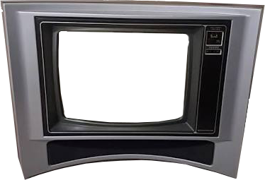
        </div>
        <div class="remote teach-ch" id="remote">
          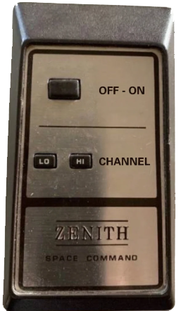
          <button class="rbtn r-pwr" id="rPwr" aria-label="Apagar el televisor"></button>
          <button class="rbtn r-lo" id="rLo" aria-label="Canal anterior"></button>
          <button class="rbtn r-hi" id="rHi" aria-label="Canal siguiente"></button>
        </div>
      </div>
    </div>
  </section>

  <!-- PORTADA: el casete con los carretes girando -->
  <section class="page cover" id="p-portada" data-side="0">
    <div class="cover-in">
      <div class="cover-cas">
        <div class="cas">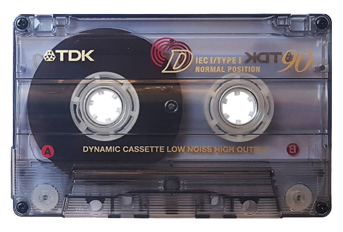<i class="hub l"></i><i class="hub r"></i></div>
      </div>
      <div class="cover-txt">
        <h1 class="title">Grandes <b>40</b> éxitos de Harrison!</h1>
        <p class="sub">Una mezcla grabada a mano con 40 años de recuerdos y una invitación al final.</p>
        <div class="deck">
          <button class="deckbtn primary" id="playBtn">▶ PLAY</button>
        </div>
      </div>
    </div>
  </section>

  <!-- LAS PISTAS (seguidas, sin lados) -->
  <section class="page" id="p-radio" data-side="cinta" data-label="PISTA 1">
    <article class="track">
      <div class="track-head">
        <h3><span class="n">Pista 1</span> Grabar de la radio</h3>
        <p class="desc">Prende el radio y oprime REC justo cuando la cuenta llegue a cero, antes de que el locutor vuelva a hablar encima.</p>
        <div class="lcd" aria-live="polite"><span id="radioLcd">Casete virgen de 90 minutos listo.</span><b class="lcd-count" id="radioCount"></b></div>
        <p class="say" id="radioSay" aria-live="polite"></p>
        <div class="btnrow">
          <button class="btn hot glow" id="radioOn">📻 Prender el radio</button>
          <button class="btn" id="radioRestart" hidden>⟲ Reiniciar</button>
          <button class="btn hot" id="radioNext" hidden>Siguiente pista ▸</button>
        </div>
      </div>
      <div class="track-body">
        <!-- La grabadora: REC (tecla roja) y PLAY (primera tecla) son zonas táctiles encima de la imagen (510x423). -->
        <div class="radio" id="radio">
          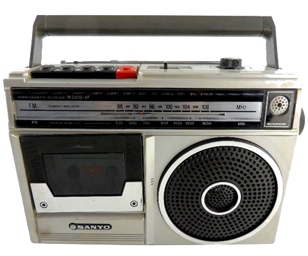
          <button class="rkey r-rec" id="radioRec" aria-label="REC: grabar"></button>
          <span class="rkey r-play" aria-hidden="true"></span>
        </div>
      </div>
    </article>
  </section>

  <section class="page" id="p-tel" data-side="cinta" data-label="PISTA 2">
    <article class="track track-tel">
      <div class="track-head">
        <h3><span class="n">Pista 2</span> Los teléfonos naranjas</h3>
        <div class="relato">
          <p>Estaban en todas las esquinas de Bogotá, firmes bajo la lluvia, esperándonos.</p>
          <p>No tenían pantalla ni contactos guardados. No hacían falta: los números nos los sabíamos de memoria. El de la casa, el del mejor amigo, el de la niña que nos gustaba y que marcábamos con el corazón en la garganta, rogando que no contestara el papá.</p>
          <p>Una moneda pequeña y fría, apretada en la mano todo el camino hasta la esquina, como si fuera un tesoro. Porque lo era: valía tres minutos de mundo.</p>
          <p>Y si hoy pudiera echar una moneda y llamar al pasado diría una sola cosa antes de que se corte la línea:</p>
          <p class="cita">“Tranquilo, amig@. Lo mejor está por venir.”</p>
        </div>
      </div>
      <div class="track-body">
        <!-- La foto con la moneda: la ficha vuela desde el botón hasta la ranura del teléfono (en % de tel.png, 645x470). -->
        <div class="telfoto" id="telFoto">
          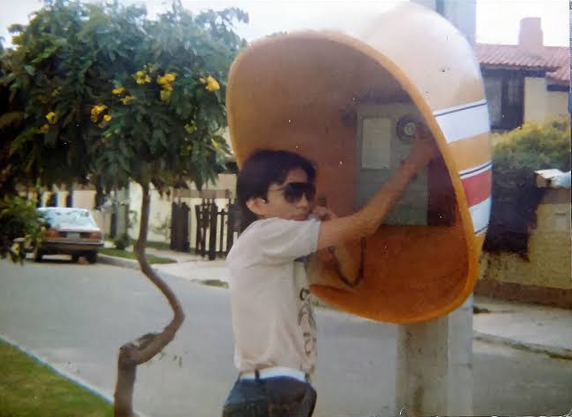
          <span class="moneda" id="moneda" aria-hidden="true"></span>
          <p class="tel-say" id="callSay" aria-live="polite"></p>
          <p class="tel-pregunta" id="telPregunta">¿A quién llamarías hoy desde este teléfono?</p>
          <div class="tel-acc">
            <button class="btn hot glow" id="fichaBtn"><span class="ficha"></span>Insertar moneda</button>
            <button class="btn hot" id="telNext" hidden>Siguiente pista ▸</button>
          </div>
        </div>
      </div>
    </article>
  </section>

  <section class="page" id="p-juegos" data-side="cinta" data-label="PISTA 3">
    <article class="track">
      <div class="track-head">
        <h3><span class="n">Pista 3</span> Los juegos</h3>
        <p class="desc">Si usted jugó alguno de estos juegos, toca decirle la verdad: la cédula ya pesa más de lo normal.</p>
        <p class="desc">Pero tranquilo, también significa que tuvo una infancia brutal llena de amigos y trasnochadas.</p>
        <p class="juegos-aviso" id="juegosAviso">👉 Mira todos los juegos del carrete para descubrir la siguiente pista.</p>
        <p class="pregunta" id="juegosPregunta" hidden>¿Cuál faltó en esta lista de juegos legendarios?</p>
        <div class="btnrow"><button class="btn hot" id="juegosNext" hidden>Siguiente pista ▸</button></div>
      </div>
      <div class="track-body">
        <!-- Carrusel: se arma desde JUEGOS (js/contenido.js); pasa solo cada pocos segundos y también con las flechas o deslizando. -->
        <div class="carrusel guiar" id="carrusel" aria-roledescription="carrusel">
          <div class="slides" id="slides"></div>
          <button class="car-btn car-prev" id="carPrev" aria-label="Juego anterior">◀</button>
          <button class="car-btn car-next" id="carNext" aria-label="Juego siguiente">▶</button>
        </div>
        <div class="car-dots" id="carDots"></div>
      </div>
    </article>
  </section>

  <section class="page" id="p-chat" data-side="cinta" data-label="PISTA 4">
    <article class="track">
      <div class="track-head">
        <h3><span class="n">Pista 4</span> Conectado en el chat</h3>
        <p class="desc" id="chatDesc">Antes de chatear había que conectarse a internet... y rogar que nadie levantara el teléfono de la casa.</p>
        <div class="btnrow">
          <button class="btn hot glow" id="buzzBtn" hidden>📳 Enviar zumbido</button>
          <button class="btn hot" id="chatNext" hidden>Siguiente pista ▸</button>
        </div>
      </div>
      <div class="track-body">
        <!-- msn.png (618x416) difuminada hasta conectarse. Después, el chat funciona encima de la ventana de conversación:
             historial en (284,139)-(509,235), caja de texto en (284,261)-(465,313), botón Send en (467,264)-(508,291). -->
        <div class="msnimg off" id="msnImg">
          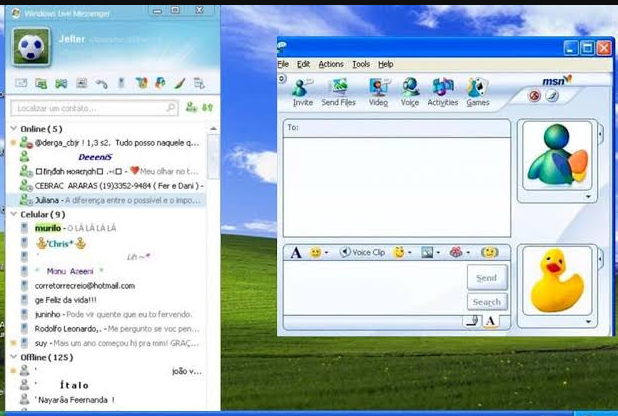
          <div class="msn-log" id="msnLog" aria-live="polite">
            <div><b>~*El Parcero*~</b> dice: q mas harrison!! ya llego el sabado</div>
            <div><b>~*El Parcero*~</b> dice: ¿vamos a la rumba o qué?</div>
          </div>
          <form class="msn-in" id="msnForm">
            <textarea id="msnInput" aria-label="Escribe un mensaje" placeholder="Escribe aquí y oprime Send..." maxlength="120" rows="2"></textarea>
            <button type="submit" class="msn-send" aria-label="Enviar mensaje"></button>
          </form>
          <!-- Ventanita de conexión telefónica (tipo Windows XP) -->
          <div class="dialup" id="dialup" role="dialog" aria-labelledby="dialTitle">
            <div class="dialup-bar" id="dialTitle">Conexión a Internet</div>
            <div class="dialup-body">
              <p id="dialSay">Su equipo no está conectado a Internet.</p>
              <div class="dialup-prog"><i id="dialProg"></i></div>
              <button class="dialup-btn" id="dialBtn">🌐 Conectar a internet</button>
            </div>
          </div>
        </div>
      </div>
    </article>
  </section>

  <section class="page" id="p-cel" data-side="cinta" data-label="PISTA 5">
    <article class="track track-cel">
      <div class="track-head">
        <h3><span class="n">Pista 5</span> El primer celular</h3>
        <p class="desc">160 caracteres por mensaje y el saldo contado. Para avisar que llegaste, mejor botar una perdida.</p>
        <p class="say" id="celSay" aria-live="polite"></p>
        <div class="smsbox" id="smsBox" hidden>
          <label for="smsTxt">Mensaje de texto</label>
          <textarea id="smsTxt">q mas! ya llgue a la casa. mñn nos vms en el ciber a las 3. bye</textarea>
          <span class="count" id="smsCount"></span>
          <div class="btnrow">
            <button class="btn" id="smsSend">Enviar SMS</button>
            <button class="btn hot glow" id="perdidaBtn">📞 Botar una perdida</button>
            <button class="btn hot" id="celNext" hidden>Siguiente pista ▸</button>
          </div>
        </div>
      </div>
      <div class="track-body">
        <!-- Nokia 1100 (268x543). Al llegar se ve su pantalla original; después se prende encima la de mensaje, en (55,124)-(218,242). -->
        <div class="n1100" id="n1100">
          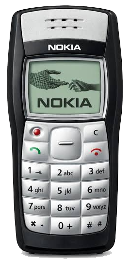
          <div class="n1100-scr" id="celScr" aria-live="polite">
            <div class="top"><span>▮▮▮</span><span id="celSaldo">Saldo $2.000</span></div>
            <div id="celTxt">Harrison<br>12:00</div>
          </div>
        </div>
      </div>
    </article>
  </section>

  <section class="page" id="p-ciber" data-side="cinta" data-label="PISTA 6">
    <article class="track track-ciber">
      <div class="track-head">
        <h3><span class="n">Pista 6</span> El internet de Centro Suba...</h3>
        <!-- La pantalla del PC: cyber.png mientras está "Sin usar"; al pedirlo cambia a cyberwin.jpg. -->
        <div class="ciber-pc" id="ciberPc">
          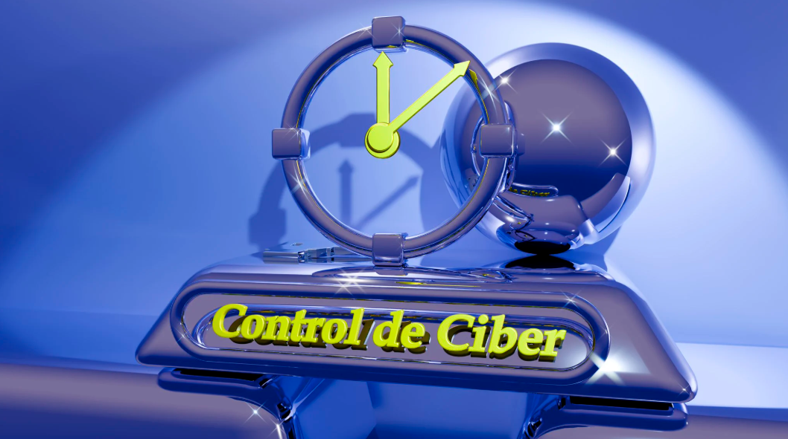
          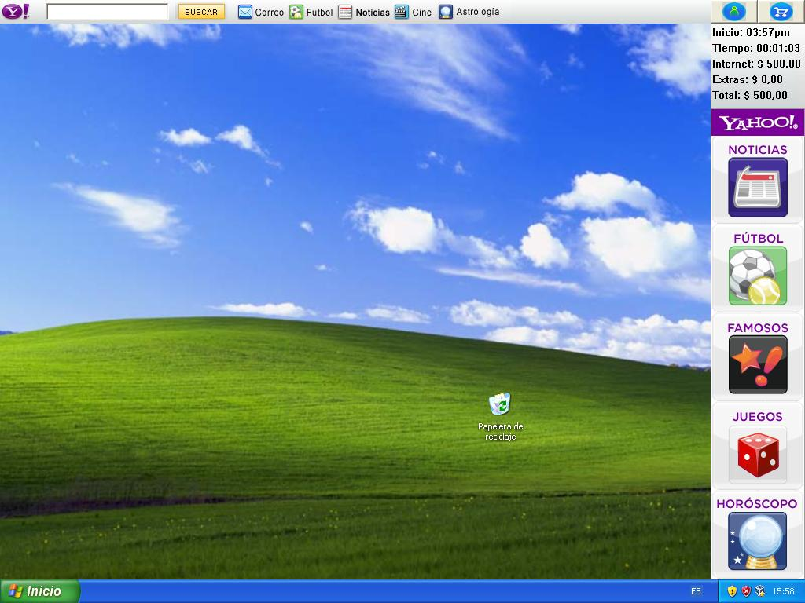
        </div>
      </div>
      <div class="track-body">
        <p class="say" id="cbSay" aria-live="polite">Pide un computador: toca «Sin usar» en la línea 3 del control del ciber.</p>
        <!-- El control del dueño (cyber-contador.png, 568x139). Filas de 15,5 px: la 2 en y 57,5-73, la 3 en y 73-88,5.
             "Sin usar" (x 149-209) se vuelve una fila igual a las de arriba y abajo: la fila 2 copiada, con hora y contador propios. -->
        <div class="ciberctl" id="ciberCtl">
          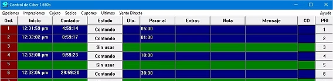
          <div class="fila3" aria-hidden="true"><span class="c-ini" id="cbIni"></span><span class="c-cont" id="cbCont">0:00:00</span></div>
          <button class="sinusar" id="sinUsar" aria-label="Sin usar: pedir el computador de la línea 3"></button>
        </div>
        <div class="btnrow"><button class="btn hot" id="ciberNext" hidden>Siguiente pista ▸</button></div>
      </div>
    </article>
  </section>

  <section class="page" id="p-fotos" data-side="cinta" data-label="PISTA 7">
    <article class="track track-fotos">
      <div class="track-head">
        <h3><span class="n">Pista 7</span> Fotos para revelar</h3>
        <p class="desc">Antes las fotos se veían días después, al recogerlas en el laboratorio. Elige fotos tuyas de esa época y míralas como se veían en el negativo del rollo. Solo se ven en tu pantalla, no se suben a ningún lado.</p>
        <div class="btnrow">
          <label class="btn hot glow upl" for="photoIn" id="fotosBtn">📷 Elegir fotos<input type="file" id="photoIn" accept="image/*" multiple></label>
          <button class="btn hot" id="fotosNext">Siguiente pista ▸</button>
        </div>
      </div>
      <div class="track-body">
        <!-- El rollo (cinta.png, 488x355): 5 cuadros entre y 146 y 196; en x 0-72, 74-150, 152-228, 230-303 y 306-376.
             Cada foto elegida entra en el siguiente cuadro y se "revela". -->
        <div class="rollo" id="rollo">
          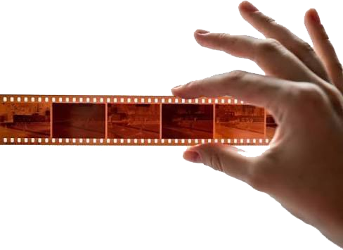
          <div class="cuadro" style="left:0%;width:14.75%"></div>
          <div class="cuadro" style="left:15.16%;width:15.57%"></div>
          <div class="cuadro" style="left:31.15%;width:15.57%"></div>
          <div class="cuadro" style="left:47.13%;width:14.96%"></div>
          <div class="cuadro" style="left:62.70%;width:14.34%"></div>
        </div>
      </div>
    </article>
  </section>

  <!-- PISTA OCULTA: pastel + invitación -->
  <section class="page finale" id="p-final" data-side="cinta" data-label="PISTA OCULTA">
    <div class="finale-in">
      <div class="fin-cake">
        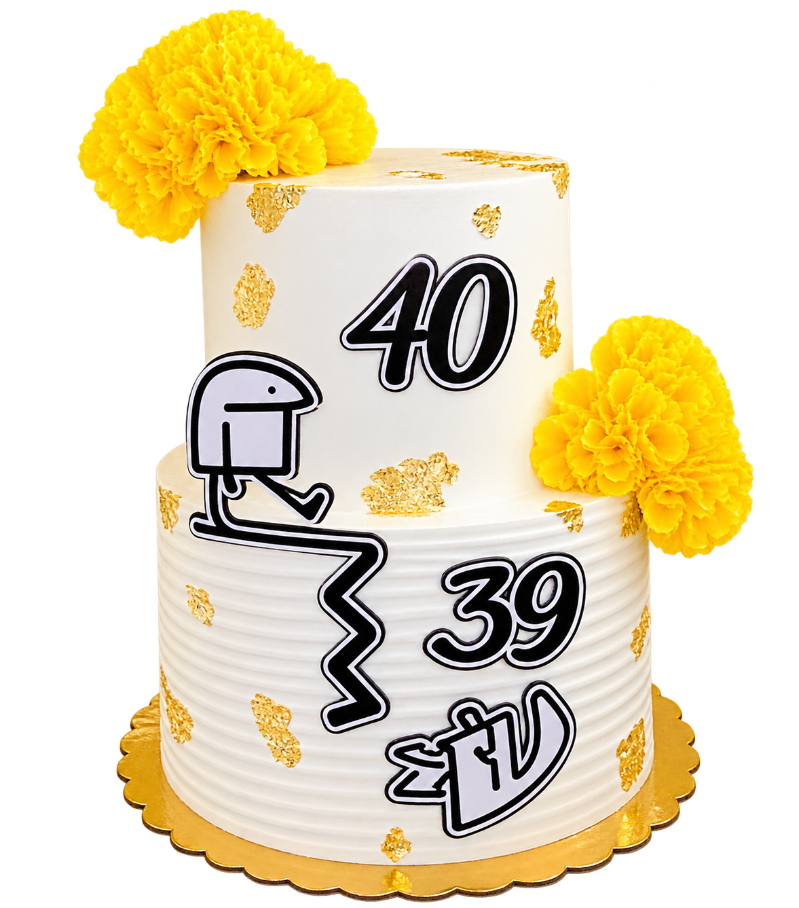
      </div>
      <div class="fin-inv">
        <span class="lado">Pista oculta · Invitación</span>
        <h2>Lo conseguiste... ¡Bienvenido a mi fiesta!!!</h2>
        <p class="inv-sub">Rifas, juegos y espectáculos.</p>
        <dl class="inv" id="inv"></dl>
        <p class="inv-conf" id="invConf"></p>
        <div class="btnrow">
          <a class="btn hot" id="rsvp" target="_blank" rel="noopener" hidden>✅ Confirmar por WhatsApp</a>
        </div>
      </div>
    </div>
  </section>

</main>

<!-- REPRODUCTOR: avanza y retrocede pista por pista -->
<nav class="deckbar intro" id="deckbar" aria-label="Reproductor del casete">
  <p class="dk-msg" id="dkMsg">Pasa por <b>todos los canales</b> y luego apaga el TV con OFF-ON para que empiece la fiesta ▸</p>
  <button class="dk" id="prevBtn" aria-label="Pista anterior">⏪</button>
  <div class="dk-mid">
    <div class="minireels" aria-hidden="true"><i class="mr-l"></i><i class="mr-r"></i></div>
    <div class="dk-info">
      <div class="dk-prog"><i id="dkProg"></i></div>
    </div>
  </div>
  <button class="dk" id="nextBtn" aria-label="Pista siguiente">⏩</button>
  <button class="chip" id="soundBtn" aria-pressed="true">Sonido: sí</button>
</nav>
<canvas id="confetti"></canvas>
</div>

<script src="js/utils.js"></script>
<script src="js/horizontal.js"></script>
<script src="js/contenido.js"></script>
<script src="js/cinta.js"></script>
<script src="js/tv.js"></script>
<script src="js/lado-a.js"></script>
<script src="js/lado-b.js"></script>
<script src="js/final.js"></script>
</body>
</html>
````

## 6. `css/styles.css`

Estilos. 446 líneas.

````css
/* Estilos de la tarjeta. Las variables de color y fuentes están en :root. */
:root{
  /* Un solo mundo visual: la sala de la casa de noche, luz de televisor. Cada pista es una página del casete. */
  --bg:#1a1319;
  --bg2:#251b22;
  --wood:#6e4224;
  --paper:#f2e4c0;
  --orange:#e8742a;
  --crt:#a6f0b0;
  --ink:#2b1e15;
  --text:#efe4d6;
  --muted:#b9a99a;
  --display:"Permanent Marker", "Comic Sans MS", cursive;
  --screen:"VT323", "Courier New", monospace;
  --body:"Rubik", system-ui, -apple-system, "Segoe UI", sans-serif;
  --deck:52px;
  /* Ancho y alto de la .app (js/horizontal.js los pone en px; si la .app está girada, son la pantalla al revés). */
  --aw:100vw;
  --ah:100vh;
  /* Márgenes seguros (muesca, barra de inicio) vistos desde la .app. */
  --st:env(safe-area-inset-top);
  --sr:env(safe-area-inset-right);
  --sb:env(safe-area-inset-bottom);
  --sl:env(safe-area-inset-left);
  color-scheme:dark;
}
*{box-sizing:border-box}
[hidden]{display:none!important}
html,body{margin:0;height:100%}
body{background:var(--bg);color:var(--text);font-family:var(--body);font-size:16px;line-height:1.5;overflow:hidden;-webkit-tap-highlight-color:transparent}
button{font:inherit;cursor:pointer}
button:focus-visible,input:focus-visible,textarea:focus-visible,label:focus-within,a:focus-visible{outline:3px solid var(--orange);outline-offset:3px}
h1,h2,h3{text-wrap:balance;margin:0}
p{margin:0}
.desc{color:var(--muted);max-width:52ch}
.say{font-family:var(--screen);font-size:22px;color:var(--crt);min-height:1.4em}
.btnrow{display:flex;gap:10px;flex-wrap:wrap;align-items:center}
.btn{background:#3a2e36;color:var(--text);border:1px solid #5a4652;border-radius:8px;padding:8px 14px;font-weight:500;text-decoration:none}
.btn:hover{background:#45373f}
.btn.hot{background:var(--orange);color:#1b0f06;border-color:#9c4614;font-weight:700}
.deck{display:flex;gap:10px;flex-wrap:wrap}
.deckbtn{background:#2f262d;color:var(--text);border:1px solid #4b3c46;border-bottom-width:4px;border-radius:8px;padding:10px 18px;font-weight:700;letter-spacing:.04em}
.deckbtn:active{transform:translateY(2px);border-bottom-width:2px}
.deckbtn.primary{background:var(--orange);border-color:#9c4614;color:#1b0f06}
.chip{background:transparent;border:1px solid #5a4652;color:var(--muted);border-radius:999px;padding:4px 12px;font-size:14px;white-space:nowrap}
@keyframes spin{to{transform:rotate(360deg)}}

/* ---------- AVISO: GIRAR EL CELULAR ---------- */
.rotate{position:fixed;inset:0;z-index:100;background:var(--bg);display:flex;flex-direction:column;align-items:center;justify-content:center;gap:12px;padding:20px;text-align:center;transition:opacity .5s}
.rotate.gone{opacity:0;pointer-events:none}
.rotate[hidden]{display:none}
.rotate h1{font-family:var(--display);font-weight:400;font-size:clamp(28px,6vw,42px);color:var(--paper)}
.rot-txt{color:var(--muted);max-width:36ch}
.rot-phone{width:44px;height:76px;border:3px solid var(--text);border-radius:9px;position:relative;animation:turn 2.4s ease-in-out infinite}
.rot-phone::after{content:"";position:absolute;left:50%;bottom:5px;width:10px;height:3px;margin-left:-5px;border-radius:2px;background:var(--text)}
@keyframes turn{0%,25%{transform:rotate(0)}55%,85%{transform:rotate(-90deg)}100%{transform:rotate(0)}}
.rot-count{display:flex;align-items:baseline;gap:8px;font-family:var(--screen);color:var(--crt)}
.rot-count b{font-size:56px;font-weight:400;line-height:1;font-variant-numeric:tabular-nums}
.rot-count span{font-size:22px}
.rot-ok,#rotGo{display:none}
.rotate.land .rot-ok{display:block;font-family:var(--screen);font-size:24px;color:var(--crt)}
.rotate.land #rotGo{display:inline-block}
.rotate.land .rot-txt{display:none}
.rotate.land .rot-phone{animation:none;transform:rotate(-90deg);border-color:var(--crt)}
.rotate.land{gap:8px}
/* En computador no hay que girar nada: solo se pide subir el volumen. */
.rot-pc{display:none;color:var(--muted);max-width:40ch}
.rotate.pc .rot-pc{display:block}
.rotate.pc .rot-phone,.rotate.pc .rot-txt,.rotate.pc .rot-ok{display:none}
.rotate.land .rot-count b{font-size:44px}

/* ---------- FORZAR HORIZONTAL ---------- */
/* Con la pantalla en vertical en un celular, la .app se gira 90° (ver js/horizontal.js).
   rot-r: celular de lado con la parte de arriba hacia la izquierda; rot-l: hacia la derecha.
   El aviso de girar solo se acuesta cuando el sensor dice que el celular ya está de lado (tilt). */
.rot .app,.rot.tilt .rotate{inset:auto;top:0;left:0;width:var(--aw);height:var(--ah);transform-origin:0 0}
.rot-r .app,.rot-r.tilt .rotate{left:var(--ah);transform:rotate(90deg)}
.rot-l .app,.rot-l.tilt .rotate{top:var(--aw);transform:rotate(-90deg)}
.rot-r{--st:env(safe-area-inset-right);--sr:env(safe-area-inset-bottom);--sb:env(safe-area-inset-left);--sl:env(safe-area-inset-top)}
.rot-l{--st:env(safe-area-inset-left);--sr:env(safe-area-inset-top);--sb:env(safe-area-inset-right);--sl:env(safe-area-inset-bottom)}

/* ---------- APP: CINTA Y PÁGINAS ---------- */
.app{position:fixed;inset:0;display:grid;grid-template-rows:minmax(0,1fr) auto}
.tape{position:relative;overflow:hidden}
.page{position:absolute;inset:0;display:grid;grid-template-rows:minmax(0,1fr);overflow-y:auto;overscroll-behavior:contain;visibility:hidden;
  padding:max(16px,var(--st)) max(16px,var(--sr)) 16px max(16px,var(--sl))}
.page.on{visibility:visible}
.page.in-r{animation:inR .45s ease both}
.page.in-l{animation:inL .45s ease both}
.page.out-l{animation:outL .45s ease both}
.page.out-r{animation:outR .45s ease both}
@keyframes inR{from{transform:translateX(100%)}}
@keyframes inL{from{transform:translateX(-100%)}}
@keyframes outL{to{transform:translateX(-100%)}}
@keyframes outR{to{transform:translateX(100%)}}
/* Zumbido: sacudida rápida (0,2 s) repetida 7 veces = 1,4 s. */
body.buzzing .tape{animation:shake .2s 7}

/* Cada pista: texto a la izquierda, el objeto a la derecha. En vertical, uno debajo del otro. */
.track{width:min(100%,980px);margin:auto;display:grid;grid-template-columns:minmax(0,5fr) minmax(0,7fr);gap:14px 32px;align-items:center}
.track-head{display:grid;gap:12px;align-content:center}
.track-body{display:grid;gap:12px;min-width:0}
.track h3{font-family:var(--display);font-weight:400;color:var(--paper);font-size:clamp(22px,calc(var(--aw) * .036),32px);display:grid;gap:2px;line-height:1.1}
.track h3 .n{font-family:var(--screen);color:var(--orange);font-size:.75em;font-weight:400}
.port .track{grid-template-columns:minmax(0,1fr)}
.short .page{padding-top:max(10px,var(--st));padding-bottom:10px}
.short .desc{font-size:14px}
.short .say{font-size:19px}

/* ---------- REPRODUCTOR (barra de abajo) ---------- */
.deckbar{--p:0;display:flex;align-items:center;gap:10px;min-height:var(--deck);background:#120d11;border-top:1px solid #3a2e36;
  padding:6px max(12px,var(--sr)) calc(6px + var(--sb)) max(12px,var(--sl))}
/* En el TV la barra solo muestra el aviso de apagarlo. */
.dk-msg{display:none;flex:1;margin:0;text-align:center;font-family:var(--screen);font-size:22px;line-height:1.1;color:var(--paper)}
.dk-msg b{color:var(--orange);font-weight:400}
.deckbar.intro>:not(.dk-msg){display:none}
.deckbar.intro .dk-msg{display:block;animation:soft 2.2s ease-in-out infinite}
@keyframes soft{50%{opacity:.6}}
.dk{flex:none;width:46px;height:36px;border-radius:8px;background:#2f262d;color:var(--text);border:1px solid #4b3c46;border-bottom-width:3px;font-size:15px}
.dk:active{transform:translateY(1px);border-bottom-width:2px}
.dk:disabled{opacity:.3;cursor:default;transform:none}
.dk-mid{flex:1;min-width:0;display:flex;align-items:center;gap:12px}
.minireels{flex:none;display:flex;gap:6px;background:#2a2a2e;border-radius:6px;padding:4px 8px}
.minireels i{position:relative;width:26px;height:26px;border-radius:50%;--t:calc(6px + 7px * (1 - var(--p)));
  background:radial-gradient(circle,#4a2e1c 0 var(--t),#1b1b1d calc(var(--t) + .5px))}
.minireels i.mr-r{--t:calc(6px + 7px * var(--p))}
.minireels i::after{content:"";position:absolute;inset:8px;border-radius:50%;background:conic-gradient(#ddd 0 50deg,#666 0 120deg,#ddd 0 170deg,#666 0 240deg,#ddd 0 290deg,#666 0)}
.deckbar.ff .minireels i::after{animation:spin .25s linear infinite}
.deckbar.rw .minireels i::after{animation:spin .25s linear infinite reverse}
.dk-info{flex:1;min-width:0;display:grid;gap:3px}
.dk-prog{height:6px;border-radius:2px;background:#2f262d;overflow:hidden}
.dk-prog i{display:block;height:100%;width:0;background:var(--orange);transition:width .45s ease}
.narrow .minireels{display:none}
.narrow .chip{padding:4px 8px;font-size:13px}

/* ---------- CASETE (imagen con carretes que giran) ---------- */
.cas{position:relative;aspect-ratio:583/395;filter:drop-shadow(0 16px 26px rgba(0,0,0,.5))}
.cas img{display:block;width:100%;height:100%}
/* Cada carrete es un círculo con la misma imagen recortada encima del original: al girar el círculo, gira el carrete.
   Las posiciones salen de los centros de los carretes en la imagen (583x395): (177,178) y (405,181), radio 34. */
.hub{position:absolute;top:36.46%;width:11.66%;aspect-ratio:1;border-radius:50%;
  background:url("../images/casete-abierto.png") no-repeat;background-size:857.35% auto}
.hub.l{left:24.53%;background-position:27.77% 44.04%}
.hub.r{left:63.64%;top:37.22%;background-position:72.04% 44.95%}

/* ---------- PORTADA ---------- */
/* El casete abierto con los carretes girando todo el tiempo; al oprimir PLAY giran más rápido. */
.cover-in{width:min(100%,980px);margin:auto;display:grid;grid-template-columns:minmax(0,1fr) minmax(0,1fr);gap:20px 36px;align-items:center}
.cover-cas{position:relative;justify-self:center;aspect-ratio:583/395;width:min(100%,calc((var(--ah) - var(--deck) - 60px) * 1.476))}
.cover .cas{position:absolute;inset:0}
.cover .hub{animation:spin 1.6s linear infinite}
.cover.playing .hub{animation-duration:.45s}
.cover-txt{display:grid;gap:10px;justify-items:start}
/* Fuente llamativa de títulos: la misma en la portada (título y subtítulo) y en cada pista. */
.title{font-family:var(--display);font-weight:400;font-size:clamp(30px,calc(var(--aw) * .054),56px);line-height:1.05;color:var(--paper)}
.title b{color:var(--orange);font-weight:400}
.sub{font-family:var(--display);font-size:clamp(17px,calc(var(--aw) * .024),24px);line-height:1.25;color:var(--paper);opacity:.75;max-width:30ch;margin-bottom:6px}
.port .cover-in{grid-template-columns:minmax(0,1fr);text-align:center}
.port .cover-txt{justify-items:center}
.port .deck{justify-content:center}
.port .cover-cas{width:min(100%,420px)}
.short .title{font-size:clamp(26px,calc(var(--aw) * .046),44px)}
.short .sub{font-size:17px}

/* ---------- TELEVISOR Y CONTROL ---------- */
.page-tv{padding-top:max(10px,var(--st));padding-bottom:8px}
.tv-intro{display:grid;grid-template-rows:auto minmax(0,1fr);gap:10px}
/* Aviso de arriba: invita a cambiar de canal (y luego a apagar), con la guía de canales vistos. */
.tv-tip{justify-self:center;max-width:100%;display:flex;flex-wrap:wrap;align-items:center;justify-content:center;gap:4px 14px;text-align:center;font-family:var(--screen);font-size:24px;line-height:1.1;color:var(--crt);
  background:#120d11;border:1px solid #3a2e36;border-radius:999px;padding:6px 18px;animation:tip 2.2s ease-in-out infinite}
.tv-tip b{color:var(--orange);font-weight:400}
@keyframes tip{50%{box-shadow:0 0 0 3px rgba(166,240,176,.25)}}
.short .tv-tip{font-size:20px;padding:4px 14px}
.guia{display:flex;gap:4px}
.guia i{font-style:normal;font-size:.82em;min-width:1.9em;padding:1px 3px;border-radius:4px;border:1px solid #4b3c46;color:#7a6a75;text-align:center;transition:background .3s,color .3s}
.guia i.visto{background:var(--crt);border-color:var(--crt);color:#10240f}
.guia i.ahora{outline:2px solid var(--orange);outline-offset:1px}
/* --h = alto del TV, lo calcula js/tv.js según el espacio libre. tv.png mide 374x255 (1.4667) y el control 257x442 (0.5814), a 92% del alto del TV. */
.tv-stage{--h:200px;min-height:0;display:flex;align-items:center;justify-content:center;gap:16px}
.tv-stage>*{flex:none;position:relative}
.tvset{height:var(--h);width:calc(var(--h) * 1.4667)}
.remote{height:calc(var(--h) * .92);width:calc(var(--h) * .92 * .5814)}
.tv-img,.remote img{position:relative;display:block;width:100%;height:100%;pointer-events:none;user-select:none;-webkit-user-select:none}
.tv-img{z-index:2;filter:drop-shadow(0 14px 22px rgba(0,0,0,.55))}
.remote img{filter:drop-shadow(0 10px 18px rgba(0,0,0,.5))}
.port .tv-stage{flex-direction:column}
.port .remote{height:calc(var(--h) * .75);width:calc(var(--h) * .75 * .5814)}
/* La pantalla va detrás del tv.png, en el hueco transparente (x 80-268, y 41-176 de 374x255). */
.crt{position:absolute;z-index:1;left:21.39%;top:16.08%;width:50.27%;height:52.94%;background:#050605;overflow:hidden;cursor:pointer}
.feed{position:absolute;inset:0;background:#000}
.feed video{position:absolute;inset:0;width:100%;height:100%;object-fit:cover;background:#000}
#snow{position:absolute;inset:0;width:100%;height:100%;image-rendering:pixelated;display:none}
.osd{position:absolute;top:12%;right:10%;font-family:var(--screen);font-size:calc(var(--h) * .058);line-height:.95;text-align:right;color:#5dff6a;text-shadow:0 0 6px #5dff6a,0 0 2px #000;opacity:0;transition:opacity .3s;z-index:3;pointer-events:none}
.osd small{display:block;font-size:.62em}
.osd.show{opacity:1}
/* Apagado a lo antiguo: la imagen se cierra en un círculo hacia el centro y queda un punto brillante que se apaga. */
.crt.off .feed{animation:crtOff .55s ease-in forwards}
.crt.off .osd{opacity:0}
@keyframes crtOff{0%{clip-path:circle(80% at 50% 50%);filter:brightness(1)}35%{filter:brightness(2.2)}100%{clip-path:circle(0% at 50% 50%);filter:brightness(3)}}
.crt .dot{position:absolute;left:50%;top:50%;width:calc(var(--h) * .037);height:calc(var(--h) * .037);border-radius:50%;background:#fff;box-shadow:0 0 calc(var(--h) * .022) calc(var(--h) * .011) #dff;transform:translate(-50%,-50%) scale(0);opacity:0;pointer-events:none}
.crt.off .dot{animation:dot 1.4s ease-out .45s both}
@keyframes dot{0%{opacity:1;transform:translate(-50%,-50%) scale(1)}100%{opacity:0;transform:translate(-50%,-50%) scale(.2)}}
.crt.boot .feed{animation:crtOn .6s ease-out}
@keyframes crtOn{0%{clip-path:circle(0% at 50% 50%);filter:brightness(3)}100%{clip-path:circle(80% at 50% 50%);filter:brightness(1)}}
/* Botones del control: zonas táctiles encima de la imagen (257x442). */
.rbtn{position:absolute;z-index:2;background:transparent;border:0;border-radius:6px;padding:0}
.rbtn.press{animation:press .25s ease}
@keyframes press{50%{background:rgba(255,255,255,.22);box-shadow:inset 0 2px 8px rgba(0,0,0,.7)}}
.r-pwr{left:23.3%;top:23.5%;width:23.7%;height:10.2%}
.r-lo{left:14.8%;top:47.1%;width:17.9%;height:9.5%}
.r-hi{left:35.4%;top:47.1%;width:17.9%;height:9.5%}
/* Guías: primero brillan LO y HI; después de cambiar de canal, brilla OFF-ON. */
.remote.teach-ch .r-lo,.remote.teach-ch .r-hi,.remote.teach-pwr .r-pwr{animation:glow 1.6s ease-in-out infinite}
/* Ya vio todos los canales: OFF-ON late fuerte y dice "¡Apágame!". */
.remote.teach-pwr .r-pwr{animation:pwrFoco 1s ease-in-out infinite}
@keyframes pwrFoco{50%{transform:scale(1.15);box-shadow:0 0 0 5px var(--orange),0 0 26px 10px rgba(232,116,42,.75)}}
.remote.teach-pwr .r-pwr::after{content:"¡Apágame!";position:absolute;bottom:calc(100% + 8px);left:50%;transform:translateX(-50%);white-space:nowrap;
  font-family:var(--screen);font-size:18px;line-height:1;color:#1b0f06;background:var(--orange);border-radius:6px;padding:3px 7px;pointer-events:none}
@keyframes glow{50%{box-shadow:0 0 0 3px rgba(232,116,42,.9),0 0 16px 5px rgba(232,116,42,.55)}}
/* Empujón: HI late más fuerte y muestra "¡Oprime!" encima. */
.remote.nudge .r-hi{animation:nudge .7s ease-in-out infinite}
@keyframes nudge{50%{transform:scale(1.18);box-shadow:0 0 0 4px var(--orange),0 0 22px 8px rgba(232,116,42,.7)}}
.remote.nudge .r-hi::after{content:"¡Oprime!";position:absolute;bottom:calc(100% + 8px);left:50%;transform:translateX(-50%);white-space:nowrap;
  font-family:var(--screen);font-size:18px;line-height:1;color:#1b0f06;background:var(--orange);border-radius:6px;padding:3px 7px;pointer-events:none}
/* "A continuación": cintillo que entra por la izquierda con el próximo canal sin ver. */
.next-up{position:absolute;left:5%;right:5%;bottom:9%;z-index:3;margin:0;font-family:var(--screen);font-size:calc(var(--h) * .048);line-height:1.1;color:#fff;
  background:linear-gradient(90deg,rgba(232,116,42,.95),rgba(180,70,20,.85));border-radius:4px;padding:.2em .5em;transform:translateX(-115%);transition:transform .45s ease;pointer-events:none}
.next-up b{font-weight:400;color:#ffe14d}
.next-up.show{transform:none}
.crt.off .next-up{display:none}
/* Aviso en pantalla tipo boletín: rojo si se apaga antes de ver todo, verde al completar los canales. */
.tv-aviso{position:absolute;inset:0;z-index:4;display:none;place-content:center;text-align:center;padding:6%;
  font-family:var(--screen);font-size:calc(var(--h) * .075);line-height:1.05;color:#fff;pointer-events:none}
.tv-aviso small{display:block;margin-top:.45em;font-size:.68em;color:#ffe14d}
.tv-aviso.show{display:grid;animation:avisoIn .3s ease}
.tv-aviso.alto{background:rgba(150,16,8,.9)}
.tv-aviso.listo{background:rgba(10,100,40,.9)}
@keyframes avisoIn{from{transform:scaleY(.04);filter:brightness(2.5)}}
/* Sin sonido: aviso grande sobre la pantalla. */
.mute-tip{display:none;position:absolute;left:50%;top:50%;transform:translate(-50%,-50%);z-index:3;margin:0;white-space:nowrap;
  font-family:var(--screen);font-size:calc(var(--h) * .07);line-height:1;color:#fff;background:rgba(0,0,0,.7);border-radius:6px;padding:.25em .6em;
  animation:blinkTip 1.2s steps(2,start) infinite;pointer-events:none}
.crt.muted .mute-tip{display:block}
.crt.off .mute-tip{display:none}
@keyframes blinkTip{50%{opacity:.55}}

/* ---------- TRANSICIÓN: DEL TV AL CASETE ---------- */
.portal-ring{position:absolute;z-index:20;border-radius:50%;pointer-events:none;
  border:3px solid #eafff0;box-shadow:0 0 24px 8px rgba(200,255,220,.55),inset 0 0 24px 8px rgba(200,255,220,.4)}

/* ---------- RADIOCASETE ---------- */
/* Pantalla de información: texto a la izquierda y la cuenta 5..1 a la derecha. */
.lcd{display:grid;grid-template-columns:minmax(0,1fr) auto;align-items:center;gap:10px;background:#9db78e;color:#16240f;font-family:var(--screen);font-size:20px;border-radius:6px;padding:6px 12px;min-height:60px;line-height:1.15;box-shadow:inset 0 0 0 3px #6f8a61}
.lcd-count{font-size:46px;font-weight:400;line-height:1;text-align:right;font-variant-numeric:tabular-nums}
.lcd-count.ya{color:#a30d00;animation:blinkTip .5s steps(2,start) infinite}
.btn.glow{animation:glow 1.6s ease-in-out infinite}
/* La grabadora (rec.png, 510x423). Teclas: PLAY = primera (x 50-88), REC = roja (x 192-228), y 104-134. */
.radio{position:relative;justify-self:center;aspect-ratio:510/423;width:min(100%,calc((var(--ah) - var(--deck) - 40px) * 1.2057))}
.radio img{display:block;width:100%;height:100%;filter:drop-shadow(0 14px 22px rgba(0,0,0,.5));user-select:none;-webkit-user-select:none;pointer-events:none}
.radio.live img{animation:thump .45s ease-in-out infinite alternate}
@keyframes thump{to{transform:scale(1.008)}}
.rkey{position:absolute;top:24.59%;height:7.09%;border:0;padding:0;border-radius:4px;background:transparent;transition:background .15s,box-shadow .15s,transform .15s}
.r-play{left:9.8%;width:7.45%;pointer-events:none}
.r-rec{left:37.65%;width:7.06%;cursor:pointer}
/* Al pasar por encima de REC o al oprimirlo, se resaltan REC y PLAY juntos (así se graba). */
.radio.armed .rkey{background:rgba(255,255,255,.28);box-shadow:0 0 0 3px var(--orange),0 0 16px 5px rgba(232,116,42,.6);transform:translateY(2px)}
@media (hover:hover){ .r-rec:hover,.r-rec:hover ~ .r-play{background:rgba(255,255,255,.28);box-shadow:0 0 0 3px var(--orange),0 0 16px 5px rgba(232,116,42,.6)} }
/* Mientras suena el jingle, REC y PLAY "se oprimen" solos para mostrar qué hay que hacer. */
.radio.demo .rkey{animation:keyDemo 1.4s ease-in-out infinite}
@keyframes keyDemo{40%,60%{background:rgba(255,255,255,.28);box-shadow:0 0 0 3px var(--orange),0 0 16px 5px rgba(232,116,42,.6);transform:translateY(2px)}}
/* ¡Ya! REC parpadea en rojo. */
.radio.now .r-rec{animation:recNow .5s steps(2,start) infinite}
@keyframes recNow{50%{box-shadow:0 0 0 4px #ff3b30,0 0 22px 8px rgba(255,59,48,.7)}}

/* ---------- LOS TELÉFONOS NARANJAS ---------- */
.track-tel{grid-template-columns:minmax(0,6fr) minmax(0,5fr)}
.relato{display:grid;gap:7px;font-size:15px;line-height:1.38;color:var(--text)}
.relato p{max-width:60ch}
.relato .cita{font-family:var(--display);font-size:1.25em;line-height:1.2;color:var(--orange)}
.short .relato{font-size:13.5px;gap:5px;line-height:1.32}
/* La foto (tel.png, 645x470). La moneda sale de abajo a la izquierda y cae en la ranura del teléfono (70.5%, 31%). */
.telfoto{position:relative;justify-self:center;aspect-ratio:645/470;width:min(100%,calc((var(--ah) - var(--deck) - 40px) * 1.3723));border-radius:10px;overflow:hidden;box-shadow:0 14px 26px rgba(0,0,0,.5)}
.telfoto img{display:block;width:100%;height:100%;object-fit:cover;filter:sepia(.15)}
.ficha{display:inline-block;width:20px;height:20px;border-radius:50%;background:radial-gradient(circle at 40% 35%,#f2d68a,#a77d26);vertical-align:-4px;margin-right:6px}
.moneda{position:absolute;left:12%;top:84%;width:7%;aspect-ratio:1;border-radius:50%;background:radial-gradient(circle at 40% 35%,#fff3c4,#e2b84a 45%,#8a6418);box-shadow:0 0 0 2px #7a5512,0 4px 10px rgba(0,0,0,.5);opacity:0;pointer-events:none;z-index:3}
.telfoto.cae .moneda{animation:moneda .95s cubic-bezier(.5,0,.6,1) forwards}
@keyframes moneda{0%{opacity:1;left:12%;top:84%;transform:translate(-50%,-50%) scale(1.2) rotateY(0)}
  55%{opacity:1;left:58%;top:14%;transform:translate(-50%,-50%) scale(1) rotateY(540deg)}
  100%{opacity:0;left:70.5%;top:31%;transform:translate(-50%,-50%) scale(.35) rotateY(900deg)}}
.tel-acc{position:absolute;left:4%;bottom:5%;z-index:4}
.tel-say{position:absolute;left:4%;top:5%;margin:0;z-index:4;font-family:var(--screen);font-size:22px;color:#fff;text-shadow:0 1px 3px #000}
.tel-pregunta{position:absolute;inset:4% 4% auto 4%;z-index:4;margin:0;padding:.45em .7em;text-align:center;font-family:var(--display);font-size:clamp(18px,calc(var(--ah) * .062),30px);line-height:1.15;color:var(--paper);
  background:rgba(20,12,18,.82);border:2px solid var(--orange);border-radius:10px;opacity:0;transform:scale(.6);transition:opacity .4s,transform .5s cubic-bezier(.2,1.4,.4,1);pointer-events:none}
.telfoto.preguntando .tel-pregunta{opacity:1;transform:none}
.port .track-tel{grid-template-columns:minmax(0,1fr)}

/* ---------- LOS JUEGOS ---------- */
/* Carrusel: una foto a la vez con su nombre grande tipo calcomanía. */
.carrusel{position:relative;justify-self:center;aspect-ratio:1.4;width:min(100%,calc((var(--ah) - var(--deck) - 70px) * 1.4));border-radius:14px;overflow:hidden;box-shadow:0 14px 26px rgba(0,0,0,.5);background:#f2d93b}
.slides{display:flex;height:100%;transition:transform .55s cubic-bezier(.65,0,.35,1)}
.slide{position:relative;flex:0 0 100%;margin:0;height:100%}
.slide img{display:block;width:100%;height:100%;object-fit:cover;user-select:none;-webkit-user-select:none}
.slide figcaption{position:absolute;left:6%;bottom:8%;font-family:var(--display);font-size:clamp(24px,calc(var(--ah) * .09),44px);line-height:1;color:#1b0f06;text-transform:uppercase;
  background:var(--orange);border:3px solid #1b0f06;border-radius:8px;padding:.15em .4em;box-shadow:5px 5px 0 #1b0f06;transform:rotate(-5deg)}
.slide.on figcaption{animation:sello .55s cubic-bezier(.2,1.6,.4,1) .25s both}
@keyframes sello{from{transform:rotate(-20deg) scale(2.2);opacity:0}}
.car-btn{position:absolute;top:50%;transform:translateY(-50%);width:44px;height:44px;border-radius:50%;border:2px solid #1b0f06;background:rgba(255,255,255,.88);color:#1b0f06;font-size:18px;z-index:2}
.car-btn:disabled{opacity:0;pointer-events:none}
.car-prev{left:8px}
.car-next{right:8px;animation:glow 1.6s ease-in-out infinite}
/* Mientras falten juegos por ver: la flecha ▶ crece, palpita en naranja y dice "¡Toca aquí!". */
.carrusel.guiar .car-next{width:56px;height:56px;font-size:22px;background:var(--orange);animation:flechaFoco 1.1s ease-in-out infinite}
@keyframes flechaFoco{50%{transform:translateY(-50%) scale(1.15);box-shadow:0 0 0 6px rgba(232,116,42,.45),0 0 26px 10px rgba(232,116,42,.6)}}
.carrusel.guiar .car-next::before{content:"¡Toca aquí!";position:absolute;right:calc(100% + 10px);top:50%;transform:translateY(-50%);white-space:nowrap;pointer-events:none;
  font-family:var(--screen);font-size:20px;line-height:1;color:#1b0f06;background:#fff;border:2px solid #1b0f06;border-radius:6px;padding:4px 8px;box-shadow:3px 3px 0 #1b0f06}
.juegos-aviso{font-family:var(--screen);font-size:22px;line-height:1.15;color:var(--crt);animation:soft 2.2s ease-in-out infinite}
.car-dots{display:flex;justify-content:center;gap:8px}
.car-dots i{width:10px;height:10px;border-radius:50%;background:#4b3c46;transition:background .3s,transform .3s}
.car-dots i.visto{background:var(--crt)}
.car-dots i.on{background:var(--orange);transform:scale(1.3)}
.pregunta{font-family:var(--display);font-size:clamp(20px,calc(var(--aw) * .028),28px);line-height:1.2;color:var(--orange);animation:sello .55s cubic-bezier(.2,1.6,.4,1) both}

/* ---------- CONECTADO EN EL CHAT ---------- */
/* msn.png (618x416) difuminada hasta conectarse; luego el chat funciona encima de la ventana de conversación. */
.msnimg{position:relative;justify-self:center;aspect-ratio:618/416;width:min(100%,calc((var(--ah) - var(--deck) - 40px) * 1.4856));border-radius:6px;overflow:hidden;box-shadow:0 14px 26px rgba(0,0,0,.5);
  font-family:Tahoma,Verdana,sans-serif;font-size:clamp(10px,calc(var(--ah) * .03),14px);color:#1a1a1a}
.msnimg>img{display:block;width:100%;height:100%;transition:filter 1s ease}
.msnimg.off>img{filter:blur(5px) saturate(.6) brightness(.85)}
.msnimg .msn-log{position:absolute;left:45.95%;top:33.41%;width:36.57%;height:23.32%;overflow-y:auto;padding:3px 5px;display:grid;align-content:start;gap:2px;background:#fff;line-height:1.25}
.msn-log .me{color:#1b5e20}
.msn-log .sys{color:#8a8a8a;font-style:italic}
.msn-log .bz{color:#c0392b;font-weight:700}
.msnimg .msn-in{position:absolute;left:45.95%;top:62.74%;width:36.57%;height:12.74%;margin:0}
.msn-in textarea{position:absolute;left:0;top:0;width:80%;height:100%;resize:none;border:0;padding:3px 5px;font:inherit;line-height:1.25;background:#fff;color:#1a1a1a}
.msn-in textarea:focus-visible{outline:2px solid #3d8bf2;outline-offset:0}
/* El botón Send de la imagen se vuelve el de enviar. */
.msn-send{position:absolute;left:81%;top:5.7%;width:18.1%;height:50.9%;border:0;padding:0;background:transparent;border-radius:3px;cursor:pointer}
.msn-send:hover,.msn-send:focus-visible{background:rgba(61,139,242,.18);outline:2px solid #3d8bf2;outline-offset:0}
.msnimg.off .msn-log,.msnimg.off .msn-in{visibility:hidden}
/* Ventanita de conexión telefónica, tipo Windows XP. */
.dialup{position:absolute;left:50%;top:50%;transform:translate(-50%,-50%);width:min(88%,300px);border-radius:7px 7px 3px 3px;overflow:hidden;background:#ece9d8;box-shadow:0 10px 30px rgba(0,0,0,.55);z-index:3;transition:opacity .5s,transform .5s}
.msnimg:not(.off) .dialup{opacity:0;transform:translate(-50%,-50%) scale(.85);pointer-events:none}
.dialup-bar{background:linear-gradient(#3d8bf2,#0c55d8 45%,#0a47b8);color:#fff;font-weight:700;padding:5px 10px;font-size:13px}
.dialup-body{display:grid;gap:10px;padding:12px;font-size:13px}
.dialup-body p{margin:0;min-height:2.5em}
.dialup-body .num{font-size:1.35em;font-weight:700;letter-spacing:.04em}
.dialup-prog{height:12px;border:1px solid #888;background:#fff;padding:1px}
.dialup-prog i{display:block;height:100%;width:0;background:repeating-linear-gradient(90deg,#2bb04a 0 8px,transparent 8px 10px)}
.dialup-btn{justify-self:center;font:inherit;font-weight:700;font-size:15px;padding:8px 16px;border:1px solid #003c74;border-radius:4px;background:linear-gradient(#fff,#e3e1d4);color:#1a1a1a;animation:glow 1.6s ease-in-out infinite}
.dialup-btn:disabled{animation:none;opacity:.6}
@keyframes shake{0%,100%{transform:translate(0)}20%{transform:translate(-8px,3px)}40%{transform:translate(7px,-4px)}60%{transform:translate(-6px,-2px)}80%{transform:translate(5px,4px)}}

/* ---------- EL PRIMER CELULAR ---------- */
.track-cel{grid-template-columns:minmax(0,7fr) minmax(0,4fr)}
/* Nokia 1100 (268x543): alto de la página; vibra mientras suena el tono. */
.n1100{--ph:min(calc(var(--ah) - var(--deck) - 40px),520px);position:relative;justify-self:center;height:var(--ph);width:calc(var(--ph) * .4936)}
.n1100 img{display:block;width:100%;height:100%;filter:drop-shadow(0 14px 22px rgba(0,0,0,.55));user-select:none;-webkit-user-select:none}
.n1100.ring{animation:vibra .12s linear infinite}
@keyframes vibra{25%{transform:translateX(-2px) rotate(-1.2deg)}75%{transform:translateX(2px) rotate(1.2deg)}}
/* Pantalla de mensaje: se prende encima de la pantalla original de la imagen, en (55,124)-(218,242). */
.n1100-scr{position:absolute;left:20.52%;top:22.84%;width:60.82%;height:21.73%;border-radius:3px;overflow:hidden;padding:3% 5%;display:flex;flex-direction:column;gap:2px;
  background:linear-gradient(#b9ceb6,#a3b9a0);color:#1c2a1a;font-family:var(--screen);font-size:calc(var(--ph) * .044);line-height:1.05;opacity:0;transition:opacity .5s}
.n1100.on .n1100-scr{opacity:1}
.n1100-scr .top{display:flex;justify-content:space-between;gap:4px;white-space:nowrap;font-size:.72em;border-bottom:1px solid rgba(28,42,26,.4)}
#celSay:empty{display:none}
#celTxt{flex:1;overflow:hidden;overflow-wrap:anywhere}
.smsbox{display:grid;gap:8px}
.smsbox label{font-size:14px;color:var(--muted)}
.short .smsbox{gap:6px}
.short .smsbox textarea{min-height:58px;font-size:18px}
.smsbox textarea{width:100%;min-height:90px;resize:vertical;background:#1a1418;color:var(--text);border:1px solid #5a4652;border-radius:8px;padding:8px;font-family:var(--screen);font-size:20px}
.count{font-family:var(--screen);font-size:20px;color:var(--crt);font-variant-numeric:tabular-nums}
.count.over{color:#ff7b6b}

/* ---------- EL INTERNET DE CENTRO SUBA ---------- */
.track-ciber{grid-template-columns:minmax(0,4fr) minmax(0,7fr)}
/* Pantalla del PC (4:3): cyber.png recortada al centro; al activarse aparece cyberwin.jpg encima. */
.ciber-pc{position:relative;aspect-ratio:4/3;width:min(100%,calc((var(--ah) - var(--deck) - 130px) * 1.3333));border:6px solid #2a2a2e;border-radius:10px;overflow:hidden;background:#000;box-shadow:0 14px 26px rgba(0,0,0,.5)}
.ciber-pc img{position:absolute;inset:0;width:100%;height:100%;object-fit:cover}
.ciber-pc .win{opacity:0;transition:opacity .8s ease}
.ciber-pc.activo .win{opacity:1;animation:pcOn .6s ease}
@keyframes pcOn{0%{filter:brightness(2.5)}100%{filter:none}}
/* Control del dueño (cyber-contador.png, 568x139). */
.ciberctl{--cw:1;position:relative;width:100%;aspect-ratio:568/139;border-radius:4px;overflow:hidden;box-shadow:0 14px 26px rgba(0,0,0,.5)}
.ciberctl img{display:block;width:100%;height:100%}
/* Fila 3 activa: un recorte de la fila 2 (x 30-537) puesto sobre la 3, con hora de inicio y contador propios. */
.fila3{display:none;position:absolute;left:5.28%;top:52.52%;width:89.26%;height:11.15%;
  background:url("../images/cyber-contador.png") no-repeat;background-size:112.03% auto;background-position:49.18% 46.56%;
  font-family:"Microsoft Sans Serif","MS Sans Serif",Tahoma,Arial,sans-serif;font-weight:700;font-size:calc(var(--cw) * 7.6px);color:#f4f4f4}
.ciberctl.activo .fila3{display:block;animation:pcOn .5s ease}
.fila3 span{position:absolute;top:8%;height:84%;display:flex;align-items:center;justify-content:center;background:rgb(3,1,124);white-space:nowrap}
.c-ini{left:.3%;width:11.3%}
.c-cont{left:12.1%;width:11.1%;font-variant-numeric:tabular-nums}
/* «Sin usar» (x 149-209, y 73-88): brilla y dice "¡Toca aquí!" hasta que se toca. */
.sinusar{position:absolute;left:26.2%;top:52.6%;width:10.7%;height:11.2%;border:0;padding:0;background:transparent;border-radius:2px;cursor:pointer;animation:glow 1.3s ease-in-out infinite}
.sinusar::after{content:"¡Toca aquí!";position:absolute;left:50%;top:calc(100% + 6px);transform:translateX(-50%);white-space:nowrap;pointer-events:none;
  font-family:var(--screen);font-size:18px;line-height:1;color:#1b0f06;background:var(--orange);border:2px solid #1b0f06;border-radius:6px;padding:3px 7px}
.ciberctl.activo .sinusar{display:none}
.ciberctl:not(.activo){overflow:visible}

/* ---------- FOTOS PARA REVELAR ---------- */
/* El rollo va a la izquierda y el texto a la derecha. */
.track-fotos{grid-template-columns:minmax(0,6fr) minmax(0,5fr)}
.track-fotos .track-body{order:-1}
.port .track-fotos .track-body{order:0}
/* cinta.png (488x355): los 5 cuadros están entre y 146 y 196 (top 41.13%, alto 14.08%). */
.rollo{position:relative;justify-self:center;aspect-ratio:488/355;width:min(100%,calc((var(--ah) - var(--deck) - 40px) * 1.3746))}
.rollo>img{display:block;width:100%;height:100%;filter:drop-shadow(0 14px 22px rgba(0,0,0,.5))}
.cuadro{position:absolute;top:41.13%;height:14.08%;overflow:hidden}
/* La foto se ve como en el negativo del rollo: colores invertidos y la máscara naranja de la película.
   Aparece desde negro (las dos listas de filtros tienen las mismas funciones para que la transición sea suave). */
.cuadro img{display:block;width:100%;height:100%;object-fit:cover;transform:scale(1.15);transition:filter 3s ease,transform 1s ease;
  filter:invert(1) grayscale(.85) contrast(.9) brightness(0)}
.cuadro img.dev{filter:invert(1) grayscale(.85) contrast(.9) brightness(1.1);transform:none}
.cuadro.con-foto::after{content:"";position:absolute;inset:0;background:rgb(222,128,52);mix-blend-mode:multiply;opacity:.85;pointer-events:none}
.upl{display:inline-flex;align-items:center;gap:8px;cursor:pointer}
.upl input{position:absolute;opacity:0;width:1px;height:1px}

/* ---------- PISTA OCULTA: PASTEL + INVITACIÓN ---------- */
.page.finale{background:radial-gradient(circle at 30% 10%,#3d2a1e,var(--bg) 70%)}
.finale-in{width:min(100%,980px);margin:auto;display:grid;grid-template-columns:minmax(0,4fr) minmax(0,7fr);gap:16px 32px;align-items:center}
.fin-cake{display:grid;justify-items:center}
/* pastel.png (1177x1337): alto de la página, el ancho sale solo */
.pastel{display:block;height:min(calc(var(--ah) - var(--deck) - 40px),440px);width:auto;max-width:100%;object-fit:contain;filter:drop-shadow(0 14px 22px rgba(0,0,0,.55))}
.fin-inv{display:grid;gap:10px;justify-items:start}
.fin-inv .lado{font-family:var(--screen);font-size:22px;color:var(--orange)}
.fin-inv h2{font-family:var(--display);font-size:clamp(26px,calc(var(--aw) * .042),42px);line-height:1.1;color:var(--paper);font-weight:400}
.inv-sub{font-family:var(--display);font-size:clamp(17px,calc(var(--aw) * .024),24px);line-height:1.2;color:var(--orange)}
.inv{display:grid;grid-template-columns:auto 1fr;gap:4px 14px;margin:0}
.inv dt{font-family:var(--screen);font-size:21px;line-height:1.2;color:var(--orange)}
.inv dd{margin:0;font-weight:500}
.inv-conf{font-weight:700;color:var(--crt)}
.port .finale-in{grid-template-columns:minmax(0,1fr)}
.port .fin-inv{justify-items:center;text-align:center}
.port .pastel{height:min(calc(var(--ah) * .46),320px)}
.short .fin-inv{gap:6px}
.short .fin-inv .lado{font-size:19px}
.short .fin-inv h2{font-size:clamp(22px,calc(var(--aw) * .034),32px)}
.short .inv-sub{font-size:17px}
.short .inv dt{font-size:18px}
.short .inv dd,.short .inv-conf{font-size:14px}
#confetti{position:absolute;inset:0;width:100%;height:100%;pointer-events:none;z-index:50}

@media (prefers-reduced-motion:reduce){
  *,*::before,*::after{animation-duration:.01ms!important;animation-iteration-count:1!important;transition-duration:.01ms!important}
}
````

## 7. `js/utils.js`

Utilidades y sonido. 48 líneas.

````js
// Utilidades compartidas: selector, pausas y sonido sintetizado.
const $ = s => document.querySelector(s);
const sleep = ms => new Promise(r => setTimeout(r, ms));

/* ---------- sonido ---------- */
let soundOn = true, ac = null;
function actx(){
  if(!soundOn) return null;
  try{ if(!ac) ac = new (window.AudioContext||window.webkitAudioContext)(); if(ac.state==='suspended') ac.resume(); }catch(e){ return null; }
  return ac;
}
function tone(freq, dur, type='sine', vol=.07, when=0){
  const a = actx(); if(!a) return;
  try{
    const o=a.createOscillator(), g=a.createGain(), t=a.currentTime+when;
    o.type=type; o.frequency.setValueAtTime(freq,t);
    g.gain.setValueAtTime(vol,t); g.gain.exponentialRampToValueAtTime(.0001,t+dur);
    o.connect(g); g.connect(a.destination); o.start(t); o.stop(t+dur+.05);
  }catch(e){}
}
function noiseBurst(dur=.25, vol=.05){
  const a=actx(); if(!a) return;
  try{
    const b=a.createBuffer(1, a.sampleRate*dur, a.sampleRate), d=b.getChannelData(0);
    for(let i=0;i<d.length;i++) d[i]=Math.random()*2-1;
    const s=a.createBufferSource(), g=a.createGain(); g.gain.value=vol;
    s.buffer=b; s.connect(g); g.connect(a.destination); s.start();
  }catch(e){}
}
// Tono monofónico de celular viejo en formato RTTTL ("nombre:d=4,o=5,b=120:notas"), con onda cuadrada como los Nokia.
// Devuelve cuántos segundos dura.
function rtttl(txt, vol=.05){
  const [, defs, notas]=txt.split(':');
  const d={d:4,o:5,b:63};
  defs.split(',').forEach(p=>{ const [k,v]=p.trim().split('='); d[k]=+v; });
  const semis={c:-9,'c#':-8,d:-7,'d#':-6,e:-5,f:-4,'f#':-3,g:-2,'g#':-1,a:0,'a#':1,b:2};
  let t=0;
  notas.split(',').forEach(n=>{
    const m=n.trim().toLowerCase().match(/^(\d+)?([a-gp]#?)(\.?)(\d)?(\.?)$/); if(!m) return;
    let dur=(60/d.b)*4/(+(m[1]||d.d)); if(m[3]||m[5]) dur*=1.5;
    if(m[2]!=='p') tone(440*Math.pow(2,(semis[m[2]]+(+(m[4]||d.o)-4)*12)/12), dur*.9, 'square', vol, t);
    t+=dur;
  });
  return t;
}
$('#soundBtn').addEventListener('click', e=>{
  soundOn=!soundOn; e.target.textContent='Sonido: '+(soundOn?'sí':'no'); e.target.setAttribute('aria-pressed', soundOn);
});
````

## 8. `js/horizontal.js`

Vista horizontal forzada. 49 líneas.

````js
// Forzar horizontal, aunque el celular tenga la rotación bloqueada.
// 1) Si la pantalla está en vertical, la invitación entera (.app) se gira 90° con CSS (clases rot, rot-r, rot-l en <html>).
// 2) En Android, al tocar PLAY se pide pantalla completa y se bloquea la pantalla en horizontal de verdad.
// Como la .app puede estar girada, el CSS no usa vw/vh ni @media de orientación: usa --aw/--ah (ancho y alto de la .app)
// y las clases port (app en vertical, solo en computador), short (app bajita) y narrow (app angosta).
const html=document.documentElement;
const tactil=matchMedia('(pointer: coarse)').matches;
const ios=/iPad|iPhone|iPod/.test(navigator.userAgent);
let giro=90;      // 90 = celular de lado con la parte de arriba hacia la izquierda; -90 = hacia la derecha
let deLado=false; // el sensor dice que el celular está de lado (Android; en iPhone el sensor pide permiso y no se usa)
function acomodar(){
  const W=innerWidth, H=innerHeight, girar=tactil && H>W;
  html.classList.toggle('rot', girar);
  html.classList.toggle('rot-r', girar && giro===90);
  html.classList.toggle('rot-l', girar && giro===-90);
  html.classList.toggle('tilt', girar && deLado);
  const aw=girar?H:W, ah=girar?W:H;
  html.style.setProperty('--aw', aw+'px'); html.style.setProperty('--ah', ah+'px');
  html.classList.toggle('port', aw<ah);
  html.classList.toggle('short', ah<=500);
  html.classList.toggle('narrow', aw<=600);
  dispatchEvent(new Event('acomodo'));
}
addEventListener('resize', acomodar);
addEventListener('orientationchange', ()=>setTimeout(acomodar,300));
acomodar();

/* ---------- sensor: hacia qué lado está el celular ---------- */
// La gravedad marca qué borde quedó arriba. Solo cambia si la posición se sostiene medio segundo.
let candidato=0, desde=0;
addEventListener('devicemotion', e=>{
  const g=e.accelerationIncludingGravity; if(!g || g.x==null) return;
  const x=ios?-g.x:g.x, y=ios?-g.y:g.y, ax=Math.abs(x);
  const lado = deLado ? ax>4 : (ax>6.5 && ax>Math.abs(y)+2);
  const nuevo = lado ? (x>0?90:-90) : 0;
  if(nuevo!==candidato){ candidato=nuevo; desde=performance.now(); return; }
  if(performance.now()-desde<500) return;
  const g2 = nuevo || giro;
  if(lado!==deLado || g2!==giro){ deLado=lado; giro=g2; acomodar(); }
});

/* ---------- bloqueo real en Android ---------- */
function bloquearHorizontal(){
  if(!/Android/i.test(navigator.userAgent) || document.fullscreenElement) return;
  try{
    const p=html.requestFullscreen({navigationUI:'hide'});
    if(p && p.then) p.then(()=>screen.orientation.lock('landscape')).catch(()=>{});
  }catch(e){}
}
````

## 9. `js/contenido.js`

Textos y datos editables. 61 líneas.

````js
// CONTENIDO EDITABLE
// Aquí están los datos de la fiesta, los videos del TV, los audios, los juegos y las respuestas del chat.
// Cambia los textos sin tocar la estructura.
// Nombres de archivo: en minúsculas, sin espacios, tildes ni símbolos (el servidor distingue mayúsculas), y que no empiecen por "_".

/* Datos de la fiesta (pista oculta). Lo que quede vacío ('') no se muestra.
   whatsapp = enlace completo de WhatsApp para confirmar (wa.me con el mensaje ya escrito). Si está vacío no sale el botón. */
const FIESTA = {
  fecha: '12 de diciembre de 2026',
  hora: '4:00 p.m. A esta hora empezamos y no quiero que te pierdas nada...',
  lugar: 'Torre Imperio Business Center. Cajicá, Cundinamarca.',
  nota: 'Llega a la hora indicada, por fa...',
  confirmar: 'Confirma tu asistencia antes del 1 de diciembre.',
  whatsapp: 'https://wa.me/573118308963?text=Hola%20Harry%2C%20confirmo%20asistencia%20a%20Tu%20Cumple%2040'
};

/* Canales del televisor (intro). El primero de la lista es el que se ve al prender.
   n = número que sale en pantalla, nombre = programa, archivo = nombre exacto del video en la carpeta videos/,
   ajuste (opcional, si no se pone queda 'cover') = 'cover' (llena la pantalla y recorta los bordes)
   o 'contain' (se ve completo, con franjas negras). Ej.: {n:4, nombre:'...', archivo:'...', ajuste:'contain'}. */
const CANALES = [
  {n:2,  nombre:'Rugrats',                    archivo:'rugrats.mp4'},
  {n:4,  nombre:'Oki Doki',                   archivo:'oki-doki.mp4'},
  {n:5,  nombre:'Supercampeones',             archivo:'supercampeones.mp4'},
  {n:7,  nombre:'El Chavo del 8',             archivo:'chavo.mp4'},
  {n:9,  nombre:'Los Caballeros del Zodiaco', archivo:'caballeros.mp4'},
  {n:11, nombre:'Dragon Ball Z',              archivo:'dragon-ball-z.mp4'}
];

/* Pista 1, grabar de la radio. jingle y cancion = nombre exacto del archivo en la carpeta sounds/.
   ventana = segundos de la canción en los que REC sale bien. emisora = lo que dice la pantalla al sintonizar. */
const RADIO = {
  jingle: 'jingle-la-mega.mp3',
  cancion: 'mis-ojos.mp3',
  ventana: [5, 8],
  emisora: '90.9 FM'
};

/* Pista 3, los juegos: nombre (sale grande encima de la foto) e imagen en la carpeta images/. Salen en este orden. */
const JUEGOS = [
  {nombre:'Canicas',      img:'canicas.png'},
  {nombre:'Coca',         img:'coca.png'},
  {nombre:'Rejo quemado', img:'rejo-quemado.png'},
  {nombre:'Trompo',       img:'trompo.png'},
  {nombre:'Yermis',       img:'yermis.png'}
];

/* Pista 5, el celular: tono que suena al llegar, antes de prender la pantalla de mensaje.
   mp3 = archivo en la carpeta sounds/ (si se pone, suena ese). rtttl = tono monofónico en formato RTTTL, el de los Nokia
   ("nombre:d=duración,o=octava,b=velocidad:notas"); solo se usa si mp3 está vacío. maximo = segundos como mucho. */
const TONO_CEL = {
  mp3: 'ringtone.mp3',
  rtttl: 'Relleno:d=8,o=6,b=150:e,g,a,4p,a,c7,a,g,e,4p,e,g,a,g,e,d,4e,4p,e,g,a,4c7,b,a,4g',
  maximo: 10
};

/* Pista 4, el chat: sonido del módem al conectarse (carpeta sounds/). */
const MODEM = 'modem.mp3';

/* Respuestas del amigo en el chat (salen en orden) */
const replies=['jajaja sii','parce, ¿y si mejor vamos al ciber mañana?','ya cambie mi foto de hi5, comentela','brb mi mamá necesita el telefono','dale, confirmado'];
````

## 10. `js/cinta.js`

Navegación, barra, transición y portada. 143 líneas.

````js
// La cinta: aviso para girar el celular, páginas, reproductor de abajo, paso del TV al casete y portada.
// Cada <section class="page"> es una página. data-side dice dónde va (intro = el TV, 0 = portada, cinta = las pistas)
// y data-label lo que muestra el reproductor. Las pistas van seguidas, de la 1 a la pista oculta.
// Orden: aviso → TV → (apagar el TV) → portada → pistas. Al TV no se vuelve.

/* ---------- AVISO: GIRAR EL CELULAR ---------- */
// "De lado" = la pantalla está en horizontal, o el sensor dice que el celular ya está de lado (ver js/horizontal.js).
const rot=$('#rotate');
let rotLeft=15, rotInt;
function rotCheck(){ rot.classList.toggle('land', !tactil || innerWidth>=innerHeight || html.classList.contains('tilt')); }
addEventListener('acomodo', rotCheck);
rotCheck();
// En computador (sin pantalla táctil) el aviso no pide girar: pide subir el volumen.
if(!tactil){ rot.classList.add('pc'); $('#rotTitle').textContent='Sube el volumen'; }
// Al cerrar el aviso arranca la primera página (el TV).
function rotClose(){
  if(rot.classList.contains('gone')) return;
  clearInterval(rotInt); rot.classList.add('gone'); setTimeout(()=>{ rot.hidden=true; },500);
  const h=hooks[pages[at].id]; if(h && h.enter) h.enter();
}
rotInt=setInterval(()=>{ rotLeft--; $('#rotNum').textContent=rotLeft; if(rotLeft<=0) rotClose(); },1000);
// Tocar "Continuar" es el gesto que deja sonar el video y, en Android, bloquear la pantalla en horizontal.
$('#rotGo').addEventListener('click', ()=>{ bloquearHorizontal(); unlockMedia(); rotClose(); });

/* ---------- PÁGINAS ---------- */
// Otras secciones se enganchan con onPage('id-de-la-page', {enter(){...}, leave(){...}}).
const pages=[...document.querySelectorAll('.page')], hooks={};
let at=0, moving=false;
function onPage(id, h){ hooks[id]=h; }
const sideOf = p => pages.filter(x=>x.dataset.side===p.dataset.side);
function show(i, dir=1){
  if(i===at || i<0 || moving) return;
  moving=true;
  const from=pages[at], to=pages[i];
  if(hooks[from.id] && hooks[from.id].leave) hooks[from.id].leave();
  from.classList.add(dir>0?'out-l':'out-r'); to.classList.add('on', dir>0?'in-r':'in-l'); to.scrollTop=0;
  at=i; deck(dir);
  if(hooks[to.id] && hooks[to.id].enter) hooks[to.id].enter();
  setTimeout(()=>{ from.classList.remove('on','out-l','out-r'); to.classList.remove('in-r','in-l'); moving=false; },450);
}
const goPage = (id, dir) => show(pages.indexOf(document.getElementById(id)), dir);
// Una pista cerrada no deja avanzar (⏩, deslizar, flechas) hasta que se complete: cerrar(id) / abrir(id).
const cerradas=new Set();
function cerrar(id){ cerradas.add(id); if(pages[at].id===id) deck(); }
function abrir(id){ cerradas.delete(id); if(pages[at].id===id) deck(); }
function step(d){
  const p=pages[at], list=sideOf(p), k=list.indexOf(p)+d;
  if(p.dataset.side!=='cinta' || k<0 || k>=list.length || (d>0 && cerradas.has(p.id))) return;
  tone(d>0?900:700,.3,'sawtooth',.02); noiseBurst(.25,.02);
  show(pages.indexOf(list[k]), d);
}

/* ---------- DEL TV AL CASETE ---------- */
// Al apagar el TV queda un punto de luz. La sala se va "hacia adentro" de ese punto
// mientras el punto se abre en un círculo de luz que deja ver el casete.
// (x, y) = centro de la pantalla del TV en coordenadas de la página (sirve igual con la .app girada).
function centroEn(el, page){
  let x=el.offsetWidth/2, y=el.offsetHeight/2;
  for(let n=el; n && n!==page; n=n.offsetParent){ x+=n.offsetLeft; y+=n.offsetTop; }
  return {x, y};
}
function portal(id, x, y){
  if(moving) return;
  const from=pages[at], to=document.getElementById(id);
  if(matchMedia('(prefers-reduced-motion: reduce)').matches || !to.animate){ show(pages.indexOf(to), 1); return; }
  moving=true;
  if(hooks[from.id] && hooks[from.id].leave) hooks[from.id].leave();
  const W=from.clientWidth, H=from.clientHeight, R=Math.ceil(Math.hypot(Math.max(x,W-x), Math.max(y,H-y)));
  const ease='cubic-bezier(.65,0,.35,1)';
  to.classList.add('on'); to.scrollTop=0; at=pages.indexOf(to); deck(1);
  // La sala se mete en el punto de luz.
  from.style.transformOrigin=`${x}px ${y}px`;
  const zoom=from.animate([{transform:'scale(1)',opacity:1},{transform:'scale(9)',opacity:0}],{duration:1100,easing:'cubic-bezier(.55,0,.75,.4)',fill:'forwards'});
  // El punto se abre como ventana al casete, con un anillo de luz en el borde.
  const clip=to.animate([{clipPath:`circle(0px at ${x}px ${y}px)`},{clipPath:`circle(${R}px at ${x}px ${y}px)`}],{duration:1150,delay:300,easing:ease,fill:'backwards'});
  const ring=document.createElement('div'); ring.className='portal-ring';
  ring.style.cssText=`left:${x}px;top:${y}px;width:${R*2}px;height:${R*2}px`; $('#tape').appendChild(ring);
  ring.animate([{transform:'translate(-50%,-50%) scale(0)',opacity:1},{transform:'translate(-50%,-50%) scale(1)',opacity:0}],{duration:1150,delay:300,easing:ease,fill:'both'});
  const cas=to.querySelector('.cover-cas');
  if(cas) cas.animate([{transform:'scale(.35) rotate(-28deg)',opacity:0},{opacity:1,offset:.4},{transform:'none',opacity:1}],{duration:1300,delay:350,easing:'cubic-bezier(.2,1.3,.4,1)',fill:'backwards'});
  [330,440,554,659,880].forEach((f,i)=>tone(f,.35,'triangle',.04,.3+i*.11)); noiseBurst(.6,.02);
  clip.onfinish=()=>{
    from.classList.remove('on'); zoom.cancel(); from.style.transformOrigin=''; ring.remove(); moving=false;
    if(hooks[to.id] && hooks[to.id].enter) hooks[to.id].enter();
  };
}

/* ---------- REPRODUCTOR ---------- */
// En el TV la barra solo muestra el aviso de apagarlo; con el casete aparecen los controles.
const bar=$('#deckbar');
let deckT;
function deck(dir=0){
  const p=pages[at], s=p.dataset.side, cover=s!=='cinta', list=sideOf(p), k=list.indexOf(p);
  const pr = cover ? 0 : k/(list.length-1);
  bar.classList.toggle('intro', s==='intro');
  $('#dkProg').style.width = pr*100+'%';
  bar.style.setProperty('--p', pr);
  $('#prevBtn').disabled = cover || k===0;
  $('#nextBtn').disabled = cover || k===list.length-1 || cerradas.has(p.id);
  if(dir){ bar.classList.remove('ff','rw'); void bar.offsetWidth; bar.classList.add(dir>0?'ff':'rw');
    clearTimeout(deckT); deckT=setTimeout(()=>bar.classList.remove('ff','rw'),700); }
}
$('#prevBtn').addEventListener('click', ()=>step(-1));
$('#nextBtn').addEventListener('click', ()=>step(1));
document.addEventListener('keydown', e=>{
  if(e.target.closest('input,textarea') || !rot.hidden) return;
  if(e.key==='ArrowRight') step(1);
  if(e.key==='ArrowLeft') step(-1);
});
// Deslizar con el dedo sobre un elemento: fn(1) al deslizar hacia la izquierda (siguiente), fn(-1) hacia la derecha.
// ignorar = selector de zonas donde no cuenta (campos de texto, carruseles con su propio deslizar...).
function deslizar(el, fn, ignorar){
  let x0=null, y0=0;
  el.addEventListener('touchstart', e=>{
    if(ignorar && e.target.closest(ignorar)){ x0=null; return; }
    x0=e.touches[0].clientX; y0=e.touches[0].clientY;
  },{passive:true});
  el.addEventListener('touchend', e=>{
    if(x0===null) return;
    let dx=e.changedTouches[0].clientX-x0, dy=e.changedTouches[0].clientY-y0; x0=null;
    // Si la .app está girada, lo que la persona ve como horizontal es vertical en la pantalla.
    if(html.classList.contains('rot-r')) [dx,dy]=[dy,-dx];
    if(html.classList.contains('rot-l')) [dx,dy]=[-dy,dx];
    if(Math.abs(dx)>50 && Math.abs(dx)>Math.abs(dy)*1.5) fn(dx<0?1:-1);
  });
}
// Deslizar sobre la página cambia de pista.
deslizar($('#tape'), step, 'input,textarea,.remote,.carrusel');

/* ---------- PORTADA ---------- */
// Un toque del usuario "desbloquea" los videos para que luego puedan sonar (iPhone lo exige).
function unlockMedia(){
  document.querySelectorAll('video').forEach(v=>{ const pr=v.play(); v.pause(); if(pr) pr.catch(()=>{}); });
}
$('#playBtn').addEventListener('click', async ()=>{
  if(moving) return;
  bloquearHorizontal(); tone(180,.08,'square',.06);
  const c=$('#p-portada'); c.classList.add('playing');
  await sleep(1300); goPage('p-radio', 1);
  setTimeout(()=>c.classList.remove('playing'),500);
});

deck();
````

## 11. `js/tv.js`

Intro: televisor y control remoto. 121 líneas.

````js
// El televisor: primera página después del aviso. Videos y control remoto (OFF-ON, LO, HI).
// LO y HI cambian de canal; OFF-ON apaga el TV y eso lleva al casete (js/cinta.js, portal). Al TV no se vuelve.
// OFF-ON solo funciona después de pasar por todos los canales; antes sale un aviso en la pantalla.
// Los canales se editan en js/contenido.js (CANALES)
/* ---------- TELEVISOR ---------- */
let ch=0, tvOn=true, onTV=false, zapId=0, snowing=false, osdT, nudgeT, nextT;
const vid=$('#tvVid'), crt=$('#crt'), cv=$('#snow'), cx=cv.getContext('2d'), hint=$('#tvHint'), remote=$('#remote');
const TIP_CANAL=hint.innerHTML, TIP_APAGAR='¡Viste todos los canales! Ahora apaga el TV con <b>OFF-ON</b>.';

/* ---------- canales vistos ---------- */
// La guía de arriba muestra los números de canal; se encienden a medida que se ven.
const vistos=new Set([0]);
const faltan=()=>CANALES.length-vistos.size;
function guia(){
  $('#tvGuia').innerHTML=CANALES.map((c,i)=>`<i class="${vistos.has(i)?'visto':''}${i===ch?' ahora':''}">${String(c.n).padStart(2,'0')}</i>`).join('');
}
// Aviso grande en la pantalla del TV (tipo boletín). cls: 'alto' (rojo) o 'listo' (verde).
function aviso(html, cls, ms){
  const a=$('#tvAviso'); a.innerHTML=html; a.className='tv-aviso show '+cls;
  clearTimeout(aviso.t); aviso.t=setTimeout(()=>{ a.className='tv-aviso'; },ms);
}
// Empujón: si se queda 7 s en un canal sin haber visto todos, sale "A continuación" con el próximo canal sin ver
// y el botón HI dice "¡Oprime!".
function empujar(){
  clearTimeout(nudgeT);
  if(!faltan()) return;
  nudgeT=setTimeout(()=>{
    if(!tvOn || !onTV || !faltan()) return;
    let d=1; while(vistos.has((ch+d)%CANALES.length)) d++;
    const c=CANALES[(ch+d)%CANALES.length], n=$('#nextUp');
    n.innerHTML=`A CONTINUACIÓN ▸ Canal ${String(c.n).padStart(2,'0')}: ${c.nombre} <b>· oprime HI</b>`; n.classList.add('show');
    clearTimeout(nextT); nextT=setTimeout(()=>n.classList.remove('show'),4500);
    remote.classList.add('nudge'); tone(990,.08,'sine',.04); tone(1320,.1,'sine',.04,.1);
    empujar();
  },7000);
}
function completar(){
  clearTimeout(nudgeT); $('#nextUp').classList.remove('show');
  remote.className='remote teach-pwr'; hint.innerHTML=TIP_APAGAR;
  $('#dkMsg').innerHTML='¡Listo! <b>Apaga el TV</b> con el botón OFF-ON y que empiece la fiesta ▸';
  aviso('¡VISTE TODOS LOS CANALES!<small>Ya puedes apagar el TV</small>','listo',3000);
  [523,659,784,1047].forEach((f,i)=>tone(f,.18,'triangle',.05,i*.12));
}
function snowLoop(){
  if(!snowing) return;
  const img=cx.createImageData(cv.width,cv.height), d=img.data;
  for(let i=0;i<d.length;i+=4){ const v=Math.random()*255|0; d[i]=d[i+1]=d[i+2]=v; d[i+3]=255; }
  cx.putImageData(img,0,0); requestAnimationFrame(snowLoop);
}
function snow(on){ const was=snowing; snowing=on; cv.style.display=on?'block':'none'; if(on&&!was) snowLoop(); }
function osd(){
  const c=CANALES[ch], o=$('#osd');
  o.innerHTML=`CANAL ${String(c.n).padStart(2,'0')}<small>${c.nombre}</small>`; o.classList.add('show');
  clearTimeout(osdT); osdT=setTimeout(()=>o.classList.remove('show'),2600);
}
function tune(){
  const c=CANALES[ch];
  vid.src='videos/'+encodeURIComponent(c.archivo);
  vid.style.objectFit=c.ajuste||'cover';
}
// Si el navegador no deja sonar el video (nadie ha tocado la pantalla), arranca en silencio
// y la pantalla del TV dice "Toca aquí para oír". El primer toque en cualquier parte le pone sonido.
function muted(on){ vid.muted=on; crt.classList.toggle('muted', on); }
function playTV(){
  if(!tvOn || !onTV) return;
  muted(!soundOn);
  const pr=vid.play();
  if(pr) pr.catch(()=>{ muted(true); vid.play().catch(()=>{}); });
}
document.addEventListener('click', ()=>{
  if(onTV && tvOn && vid.muted && soundOn){ muted(false); if(vid.paused) vid.play().catch(()=>{}); }
  if(onTV) bloquearHorizontal();
}, true);
function apagar(){
  if(!tvOn) return;
  const f=faltan();
  if(f){
    aviso(`¡ESPERA!<br>Te ${f===1?'falta 1 canal espectacular':`faltan ${f} canales espectaculares`}.<small>Oprime HI y no te ${f===1?'lo':'los'} pierdas</small>`,'alto',3500);
    tone(300,.12,'square',.06); tone(300,.12,'square',.06,.18);
    remote.classList.add('nudge');
    return;
  }
  tvOn=false; zapId++; clearTimeout(nudgeT);
  $('#tvAviso').className='tv-aviso'; $('#nextUp').classList.remove('show');
  crt.classList.remove('boot'); crt.classList.add('off'); snow(false); remote.className='remote';
  tone(80,.15,'sine',.08); hint.textContent='¡Ahora sí, que empiece la fiesta!';
  setTimeout(()=>{ vid.pause(); const c=centroEn(crt, $('#p-tv')); portal('p-portada', c.x, c.y); },750);
}
async function zap(d){
  if(!tvOn) return;
  tone(120,.05,'square',.08);
  ch=(ch+d+CANALES.length)%CANALES.length; const me=++zapId;
  vid.pause(); snow(true); noiseBurst(.4,.04); tune(); osd();
  $('#nextUp').classList.remove('show'); remote.classList.remove('nudge');
  const nuevo=!vistos.has(ch); vistos.add(ch); guia();
  if(nuevo && !faltan()) completar(); else { empujar(); if(faltan()) hint.innerHTML=TIP_CANAL; }
  await sleep(450); if(me!==zapId || !tvOn) return;
  snow(false); playTV();
}
// Alto del TV (--h) según el espacio libre: TV y control lado a lado (o uno encima del otro si la app está en vertical).
// Máximo 560 px: los videos son de 640x360 y en una pantalla de computador más grande se verían borrosos.
const stage=$('.tv-stage');
function fitTV(){
  const w=stage.clientWidth, h=stage.clientHeight;
  const tvH = Math.min(560, html.classList.contains('port') ? Math.min((h-16)/1.75, w/1.4667) : Math.min(h, (w-16)/2.002));
  stage.style.setProperty('--h', Math.max(60,Math.floor(tvH))+'px');
}
if(window.ResizeObserver) new ResizeObserver(fitTV).observe(stage);
addEventListener('acomodo', fitTV);
fitTV();
function press(b){ b.classList.remove('press'); void b.offsetWidth; b.classList.add('press'); }
$('#rPwr').addEventListener('click', e=>{ press(e.currentTarget); apagar(); });
$('#rLo').addEventListener('click', e=>{ press(e.currentTarget); zap(-1); });
$('#rHi').addEventListener('click', e=>{ press(e.currentTarget); zap(1); });
vid.addEventListener('error', ()=>{ if(tvOn && vid.getAttribute('src')){ snow(true); hint.textContent='Este canal no tiene señal. Prueba con LO o HI.'; } });
// Al TV no se vuelve: al salir se suelta el video para que no siga descargando datos.
onPage('p-tv', {
  enter(){ onTV=true; tune(); crt.classList.add('boot'); tone(15000,.3,'sine',.02); playTV(); osd(); empujar(); },
  leave(){ onTV=false; clearTimeout(nudgeT); vid.pause(); vid.removeAttribute('src'); vid.load(); }
});
tune(); guia();
````

## 12. `js/lado-a.js`

Pistas 1 a 3. 134 líneas.

````js
// Pistas 1 a 3 (90s): radio, los teléfonos naranjas, los juegos.
// La portada está en js/cinta.js
/* ---------- RADIO ---------- */
// Prender el radio → estática → jingle → canción. Durante la canción, la pantalla cuenta 5..1 y hay que oprimir REC
// entre los segundos RADIO.ventana (5 a 8). Si sale bien aparece "Siguiente pista"; si no, "Reiniciar".
// La pista queda cerrada (⏩ y deslizar no avanzan) hasta grabar bien. Los audios se editan en js/contenido.js (RADIO).
// Estados: off → tuning → dj (jingle) → song (cuenta) → window (¡ya!) → late (se pasó) · done (ya oprimió REC)
let rState='off', rTimer, rLoop, rOk=false, rShown=0;
const lcd=$('#radioLcd'), rsay=$('#radioSay'), rcount=$('#radioCount'), radio=$('#radio');
const jingle=new Audio('sounds/'+encodeURIComponent(RADIO.jingle)), cancion=new Audio('sounds/'+encodeURIComponent(RADIO.cancion));
jingle.preload=cancion.preload='none';
function sonar(a){ a.muted=!soundOn; a.currentTime=0; const pr=a.play(); if(pr) pr.catch(()=>{}); }
function rStop(){
  clearTimeout(rTimer); cancelAnimationFrame(rLoop);
  [jingle,cancion].forEach(a=>a.pause());
  radio.classList.remove('live','demo','now'); rcount.textContent=''; rcount.classList.remove('ya');
}
function rAcciones(on, restart, next){ $('#radioOn').hidden=!on; $('#radioRestart').hidden=!restart; $('#radioNext').hidden=!next; }
function rArrancar(){
  rStop(); rState='tuning'; rShown=0; rsay.textContent=''; rAcciones(false,false,rOk);
  lcd.textContent=`Sintonizando... ${RADIO.emisora}`; noiseBurst(.8,.03);
  rTimer=setTimeout(()=>{
    rState='dj'; radio.classList.add('live','demo');
    lcd.textContent='LOCUTOR: ¡Buenas tardes, Bogotá! Ya viene lo más pedido de la semana...';
    rsay.textContent='Prepárate: cuando la cuenta llegue a cero, oprime ● REC.';
    sonar(jingle);
  },800);
}
jingle.addEventListener('ended', ()=>{
  if(rState!=='dj') return;
  rState='song'; radio.classList.remove('demo');
  lcd.textContent='♪ ¡ARRANCÓ LA CANCIÓN! ♫'; sonar(cancion); vigilar();
});
// Mira el segundo de la canción: cuenta 5..1, abre la ventana para grabar y la cierra.
function vigilar(){
  const t=cancion.currentTime, [a,b]=RADIO.ventana;
  if(rState==='song'){
    if(t>=a){ rState='window'; radio.classList.add('now'); lcd.textContent='● ¡GRABA AHORA!'; rcount.textContent='¡YA!'; rcount.classList.add('ya'); tone(880,.15,'square',.05); }
    else { const n=Math.ceil(a-t); if(n!==rShown){ rShown=n; rcount.textContent=n; tone(660,.06,'square',.04); } }
  }
  if(rState==='window' && t>=b){
    rState='late'; radio.classList.remove('now'); rcount.textContent=''; rcount.classList.remove('ya');
    lcd.textContent='♪ La canción sigue sonando...'; rsay.textContent='Se te pasó el comienzo. Dale a Reiniciar y vuelve a intentarlo.';
    rAcciones(false,true,rOk);
  }
  if(rState==='song' || rState==='window') rLoop=requestAnimationFrame(vigilar);
}
// Al pasar por encima de REC (o al oprimirlo) se resaltan REC y PLAY, como cuando se graba en una grabadora de verdad.
function rArmar(){ radio.classList.remove('armed'); void radio.offsetWidth; radio.classList.add('armed'); clearTimeout(rArmar.t); rArmar.t=setTimeout(()=>radio.classList.remove('armed'),700); }
$('#radioRec').addEventListener('pointerdown', rArmar);
$('#radioRec').addEventListener('click', ()=>{
  rArmar(); tone(200,.06,'square',.06);
  if(rState==='off'){ rsay.textContent='Primero prende el radio.'; return; }
  if(rState==='done'){ if(!rOk) rsay.textContent='Dale a Reiniciar para intentarlo otra vez.'; return; }
  const st=rState; rState='done'; cancelAnimationFrame(rLoop); clearTimeout(rTimer);
  radio.classList.remove('demo','now'); rcount.textContent=''; rcount.classList.remove('ya');
  if(st==='window'){
    rOk=true; abrir('p-radio');
    lcd.textContent='Grabado: canción completa, sin locutor.'; rsay.textContent='¡Perfecto! La tengo para oírla cuando quiera...';
    [523,659,784].forEach((f,i)=>tone(f,.15,'triangle',.05,i*.15));
    rAcciones(false,false,true); return;
  }
  if(st==='late'){ lcd.textContent='Grabado: canción sin el comienzo.'; rsay.textContent='Le cortaste el inicio. Toca esperar a que la vuelvan a poner.'; }
  else { lcd.textContent='Grabado: 40% locutor, 60% canción.'; rsay.textContent='Te adelantaste: quedó la voz del locutor encima.'; jingle.pause(); radio.classList.remove('live'); }
  rAcciones(false,true,rOk);
});
// Prender: el toque desbloquea los dos audios (iPhone lo exige) y arranca.
$('#radioOn').addEventListener('click', ()=>{
  [jingle,cancion].forEach(a=>{ a.preload='auto'; const pr=a.play(); a.pause(); if(pr) pr.catch(()=>{}); });
  rArrancar();
});
$('#radioRestart').addEventListener('click', rArrancar);
$('#radioNext').addEventListener('click', ()=>step(1));
$('#soundBtn').addEventListener('click', ()=>{ jingle.muted=cancion.muted=!soundOn; });
cerrar('p-radio');
onPage('p-radio', {
  enter(){ if(cancion.preload==='none'){ cancion.preload='auto'; cancion.load(); } },
  leave(){ rStop(); rState='off'; lcd.textContent='Casete virgen de 90 minutos listo.'; rsay.textContent=''; rAcciones(true,false,rOk); }
});

/* ---------- LOS TELÉFONOS NARANJAS ---------- */
// Echar la ficha: la moneda vuela hasta la ranura del teléfono de la foto, suena el tono y sale la pregunta.
// A los 3 s aparece "Siguiente pista" (la pista está cerrada hasta entonces).
let calling=false;
$('#fichaBtn').addEventListener('click', async ()=>{
  if(calling) return; calling=true;
  const foto=$('#telFoto'), s=$('#callSay'), b=$('#fichaBtn');
  b.disabled=true; s.textContent='';
  foto.classList.remove('cae','llamando','preguntando'); void foto.offsetWidth; foto.classList.add('cae');
  tone(1200,.05,'square',.03);
  await sleep(950); tone(1400,.08,'square',.05); tone(1900,.06,'square',.04,.08);
  b.hidden=true; foto.classList.add('llamando');
  for(let i=0;i<2;i++){ tone(425,.9,'sine',.1); s.textContent='Tuuu... '+'tuuu... '.repeat(i); await sleep(1300); }
  s.textContent=''; foto.classList.add('preguntando'); tone(660,.12,'triangle',.05); tone(880,.2,'triangle',.05,.12);
  await sleep(3000);
  abrir('p-tel'); $('#telNext').hidden=false; calling=false;
});
$('#telNext').addEventListener('click', ()=>step(1));
cerrar('p-tel');

/* ---------- LOS JUEGOS ---------- */
// Carrusel con JUEGOS (js/contenido.js). Pasa solo cada 3,5 s; también con las flechas o deslizando.
// Al pasar por todos sale la pregunta final y "Siguiente pista" (la pista está cerrada hasta entonces).
let jAt=0, jT;
const jVistos=new Set([0]), slides=$('#slides'), carDots=$('#carDots');
slides.innerHTML=JUEGOS.map((j,i)=>`<figure class="slide"><figcaption>${j.nombre}</figcaption></figure>`).join('');
carDots.innerHTML=JUEGOS.map(()=>'<i></i>').join('');
function jMostrar(){
  slides.style.transform=`translateX(${-jAt*100}%)`;
  [...slides.children].forEach((s,i)=>s.classList.toggle('on', i===jAt));
  [...carDots.children].forEach((d,i)=>{ d.classList.toggle('on', i===jAt); d.classList.toggle('visto', jVistos.has(i)); });
  $('#carPrev').disabled = jAt===0;
  $('#carNext').disabled = jAt===JUEGOS.length-1;
}
function jAuto(){ clearTimeout(jT); if(jAt<JUEGOS.length-1) jT=setTimeout(()=>jIr(1),3500); }
function jFin(){
  if(!$('#juegosPregunta').hidden) return;
  $('#juegosAviso').hidden=true; $('#carrusel').classList.remove('guiar');
  $('#juegosPregunta').hidden=false; $('#juegosNext').hidden=false; abrir('p-juegos');
  [523,659,784].forEach((f,i)=>tone(f,.15,'triangle',.05,i*.13));
}
function jIr(d){
  const k=jAt+d; if(k<0 || k>=JUEGOS.length) return;
  jAt=k; jVistos.add(k); tone(d>0?880:660,.06,'square',.03); jMostrar();
  if(jVistos.size===JUEGOS.length) jFin();
  jAuto();
}
$('#carPrev').addEventListener('click', ()=>jIr(-1));
$('#carNext').addEventListener('click', ()=>jIr(1));
deslizar($('#carrusel'), jIr);
$('#juegosNext').addEventListener('click', ()=>step(1));
cerrar('p-juegos');
onPage('p-juegos', { enter(){ jAuto(); }, leave(){ clearTimeout(jT); } });
jMostrar();
````

## 13. `js/lado-b.js`

Pistas 4 a 7. 142 líneas.

````js
// Pistas 4 a 7 (2000s): chat, celular, ciber, fotos.
/* ---------- CONECTADO EN EL CHAT ---------- */
// Las ventanas (msn.png) están difuminadas hasta conectarse. "Conectar a internet" suena el módem (MODEM en js/contenido.js);
// al terminar, las ventanas se ven normal y el chat funciona encima de la ventana de conversación.
// La pista se abre (y aparece "Siguiente pista") cuando se envía un zumbido.
const log=$('#msnLog'), msnImg=$('#msnImg'), modem=new Audio('sounds/'+encodeURIComponent(MODEM));
modem.preload='none';
let conectando=false, conectado=false;
const PASOS=['Marcando <b class="num">6812337</b>...','Verificando nombre de usuario y contraseña...','Registrando su equipo en la red...'];
$('#dialBtn').addEventListener('click', async ()=>{
  if(conectando || conectado) return; conectando=true;
  $('#dialBtn').disabled=true; msnImg.classList.add('marcando');
  modem.muted=!soundOn; modem.currentTime=0; const pr=modem.play(); if(pr) pr.catch(()=>{});
  // Los mensajes y la barra avanzan con el audio (o con el reloj si el audio no carga).
  const t0=performance.now(), dur=()=>(isFinite(modem.duration) && modem.duration) || 12;
  await new Promise(fin=>{
    (function paso(){
      const t=modem.paused && modem.currentTime===0 ? (performance.now()-t0)/1000 : modem.currentTime;
      $('#dialProg').style.width=Math.min(100, t/dur()*100)+'%';
      const k=Math.min(PASOS.length-1, Math.floor(t/dur()*PASOS.length));
      if(paso.k!==k){ paso.k=k; $('#dialSay').innerHTML=PASOS[k]; }
      if(modem.ended || t>=dur()) fin(); else requestAnimationFrame(paso);
    })();
  });
  $('#dialSay').textContent='Conectado a 56,0 Kbps'; $('#dialProg').style.width='100%';
  await sleep(900);
  conectando=false; conectado=true; msnImg.classList.remove('off','marcando');
  tone(660,.1,'sine',.05); tone(990,.12,'sine',.05,.1);
  $('#chatDesc').innerHTML='¡Ya estás conectado! Escríbele a tu amigo en la ventana de conversación y oprime Send. <b>Para seguir a la siguiente pista, envíale un zumbido.</b>';
  $('#buzzBtn').hidden=false;
});
function line(html, cls=''){ const d=document.createElement('div'); d.className=cls; d.innerHTML=html; log.appendChild(d); log.scrollTop=log.scrollHeight; return d; }
const esc=s=>s.replace(/[&<>"]/g,c=>({'&':'&amp;','<':'&lt;','>':'&gt;','"':'&quot;'}[c]));
let ri=0;
$('#msnForm').addEventListener('submit', async e=>{
  e.preventDefault(); if(!conectado) return;
  const v=$('#msnInput').value.trim(); if(!v) return;
  $('#msnInput').value=''; line(`<b>Harrison</b> dice: ${esc(v)}`,'me'); tone(780,.08,'sine',.05);
  await sleep(500); const escribiendo=line('~*El Parcero*~ está escribiendo...','sys'); await sleep(1200);
  escribiendo.remove(); line(`<b>~*El Parcero*~</b> dice: ${replies[ri++%replies.length]}`); tone(660,.1,'sine',.05); tone(990,.12,'sine',.05,.1);
});
// Enter envía (Shift+Enter hace salto de línea), como en el Messenger.
$('#msnInput').addEventListener('keydown', e=>{ if(e.key==='Enter' && !e.shiftKey){ e.preventDefault(); $('#msnForm').requestSubmit ? $('#msnForm').requestSubmit() : $('#msnForm').dispatchEvent(new Event('submit',{cancelable:true})); } });
$('#chatNext').addEventListener('click', ()=>step(1));
$('#soundBtn').addEventListener('click', ()=>{ modem.muted=!soundOn; });
cerrar('p-chat');
// Zumbido: vibración más rápida (pulsos de 40 ms) que dura 1,4 s. El primero abre la pista y muestra "Siguiente pista".
$('#buzzBtn').addEventListener('click', async ()=>{
  line('Has enviado un zumbido.','bz');
  document.body.classList.remove('buzzing'); void document.body.offsetWidth; document.body.classList.add('buzzing');
  for(let i=0;i<36;i++) tone(i%2?140:110,.04,'square',.06,i*.04);
  if($('#chatNext').hidden){ $('#buzzBtn').classList.remove('glow'); $('#chatNext').hidden=false; abrir('p-chat'); }
  await sleep(2000); line('<b>~*El Parcero*~</b> dice: ya ya, ¡no me zumbe más!');
});

/* ---------- EL PRIMER CELULAR ---------- */
// Al llegar la primera vez: el Nokia 1100 muestra su pantalla original, vibra y suena el tono (TONO_CEL en js/contenido.js).
// Al terminar se prende la pantalla de mensaje con el saldo y aparece el SMS. "Botar una perdida" abre la pista.
const sms=$('#smsTxt'), cnt=$('#smsCount'), celTxt=$('#celTxt'), n1100=$('#n1100');
let saldo=2000, celListo=false, perdiendo=false;
function upd(){ const n=sms.value.length, left=160-n; cnt.textContent = left>=0 ? `${left} caracteres libres` : `${-left} de más: serían 2 mensajes`; cnt.classList.toggle('over', left<0); }
sms.addEventListener('input', ()=>{ upd(); if(n1100.classList.contains('on')) celTxt.textContent=sms.value.length>48 ? '…'+sms.value.slice(-48) : sms.value; });
upd();
function setSaldo(){ $('#celSaldo').textContent='Saldo $'+saldo.toLocaleString('es-CO'); }
// Suena el tono: el mp3 si hay, si no el RTTTL. Termina cuando acaba el tono (o a los TONO_CEL.maximo segundos).
function sonarTono(){
  return new Promise(fin=>{
    const tope=setTimeout(fin, TONO_CEL.maximo*1000);
    if(TONO_CEL.mp3){
      const a=new Audio('sounds/'+encodeURIComponent(TONO_CEL.mp3)); a.muted=!soundOn;
      a.onended=()=>{ clearTimeout(tope); fin(); };
      setTimeout(()=>a.pause(), TONO_CEL.maximo*1000);
      const pr=a.play(); if(pr) pr.catch(()=>{ clearTimeout(tope); fin(); });
      return;
    }
    const s=rtttl(TONO_CEL.rtttl); clearTimeout(tope);
    setTimeout(fin, Math.min(s, TONO_CEL.maximo)*1000+300);
  });
}
async function celArrancar(){
  celListo=true;
  n1100.classList.add('ring'); $('#celSay').textContent='♪ ¡Está sonando el celular!';
  await sonarTono();
  n1100.classList.remove('ring'); n1100.classList.add('on'); tone(1800,.05,'square',.03);
  $('#celSay').textContent=''; $('#smsBox').hidden=false;
}
$('#smsSend').addEventListener('click', ()=>{
  const n=Math.max(1,Math.ceil(sms.value.length/160));
  if(saldo < n*150){ celTxt.innerHTML='Saldo insuficiente.<br>Haz una recarga.'; return; }
  saldo-=n*150; setSaldo(); tone(1200,.06,'square',.05); tone(1500,.06,'square',.05,.1);
  celTxt.innerHTML=`Mensaje enviado<br>(${n} SMS, $${(n*150).toLocaleString('es-CO')})`;
});
$('#perdidaBtn').addEventListener('click', async ()=>{
  if(perdiendo) return; perdiendo=true;
  celTxt.innerHTML='Llamando...<br>Parcero'; tone(425,.4,'sine',.05); await sleep(900);
  celTxt.innerHTML='Llamada realizada<br>Saldo intacto'; tone(300,.15,'square',.05);
  // La perdida ya cumplió: su botón le da el puesto a "Siguiente pista".
  if($('#celNext').hidden){ $('#perdidaBtn').hidden=true; $('#celNext').hidden=false; abrir('p-cel'); }
  perdiendo=false;
});
$('#celNext').addEventListener('click', ()=>step(1));
cerrar('p-cel');
onPage('p-cel', { enter(){ if(!celListo) celArrancar(); } });

/* ---------- EL INTERNET DE CENTRO SUBA ---------- */
// Tocar «Sin usar» (línea 3 del control) prende el PC: la línea queda igual a las activas, con la hora de inicio y el contador
// corriendo, la pantalla pasa de cyber.png a cyberwin.jpg y se abre la pista.
const ciberCtl=$('#ciberCtl');
let cbStart=0, cbInt;
// El texto de la fila sigue el tamaño de la imagen (--cw = ancho mostrado / 568).
function cbEscala(){ ciberCtl.style.setProperty('--cw', ciberCtl.clientWidth/568); }
if(window.ResizeObserver) new ResizeObserver(cbEscala).observe(ciberCtl);
addEventListener('acomodo', cbEscala); cbEscala();
const dos=n=>String(n).padStart(2,'0');
$('#sinUsar').addEventListener('click', ()=>{
  const d=new Date(), h=d.getHours();
  $('#cbIni').textContent=`${h%12||12}:${dos(d.getMinutes())}:${dos(d.getSeconds())} ${h<12?'am':'pm'}`;
  cbStart=Date.now(); ciberCtl.classList.add('activo'); $('#ciberPc').classList.add('activo');
  [400,800,1200,2100,1800].forEach((f,i)=>tone(f,.18,'square',.025,i*.18));
  cbInt=setInterval(()=>{ const s=Math.floor((Date.now()-cbStart)/1000); $('#cbCont').textContent=`${Math.floor(s/3600)}:${dos(Math.floor(s/60)%60)}:${dos(s%60)}`; },250);
  $('#cbSay').textContent='¡PC 3 asignado! El tiempo ya está corriendo, a $1.500 la hora.';
  $('#ciberNext').hidden=false; abrir('p-ciber');
});
$('#ciberNext').addEventListener('click', ()=>step(1));
cerrar('p-ciber');

/* ---------- FOTOS PARA REVELAR ---------- */
// Cada foto elegida entra, una por una, en el siguiente cuadro del rollo (cinta.png) y se ve como en el negativo.
// Subir fotos es opcional: "Siguiente pista" está siempre. Si se eligen más de 5, vuelven a empezar desde el primer cuadro.
const cuadros=[...document.querySelectorAll('#rollo .cuadro')];
let fotoN=0;
$('#photoIn').addEventListener('change', e=>{
  const files=[...e.target.files]; if(!files.length) return;
  files.slice(0,cuadros.length).forEach((f,i)=>setTimeout(()=>{
    const fr=cuadros[fotoN++%cuadros.length], img=new Image();
    img.alt='Foto revelada '+fotoN; img.src=URL.createObjectURL(f);
    img.onload=()=>{ fr.replaceChildren(img); fr.classList.add('con-foto'); tone(1800,.04,'square',.04); setTimeout(()=>img.classList.add('dev'),60); };
    $('#fotosBtn').classList.remove('glow');
  }, i*700));
  e.target.value='';
});
$('#fotosNext').addEventListener('click', ()=>step(1));
````

## 14. `js/final.js`

Pista oculta. 27 líneas.

````js
// Pista oculta: pastel, invitación (datos en FIESTA de js/contenido.js) y confeti al llegar.
/* ---------- INVITACIÓN ---------- */
[['Cuándo',FIESTA.fecha],['Hora',FIESTA.hora],['Dónde',FIESTA.lugar],['Ojo',FIESTA.nota]].forEach(([k,v])=>{
  if(!v) return;
  const dt=document.createElement('dt'), dd=document.createElement('dd');
  dt.textContent=k; dd.textContent=v; $('#inv').append(dt,dd);
});
$('#invConf').textContent=FIESTA.confirmar||'';
if(FIESTA.whatsapp){ const a=$('#rsvp'); a.href=FIESTA.whatsapp; a.hidden=false; }

/* ---------- PISTA OCULTA ---------- */
// La primera vez que se llega: confeti y una melodía de celebración.
let festejado=false;
onPage('p-final', { enter(){
  if(festejado) return; festejado=true;
  setTimeout(()=>{ party(); [523,523,587,523,698,659].forEach((f,i)=>tone(f,.3,'triangle',.06,i*.32)); },500);
} });
function party(){
  if(matchMedia('(prefers-reduced-motion: reduce)').matches) return;
  const c=$('#confetti'), x=c.getContext('2d'); c.width=c.clientWidth; c.height=c.clientHeight;
  const cols=['#e8742a','#f4c900','#003a8c','#ce1126','#a6f0b0','#f2e4c0','#7fc8f8'];
  const P=Array.from({length:180},()=>({x:Math.random()*c.width,y:-20-Math.random()*c.height*.5,vx:(Math.random()-.5)*2,vy:2+Math.random()*3,r:Math.random()*6.28,s:5+Math.random()*6,c:cols[Math.random()*cols.length|0]}));
  const t0=performance.now();
  (function f(t){ x.clearRect(0,0,c.width,c.height);
    P.forEach(p=>{ p.x+=p.vx; p.y+=p.vy; p.r+=.1; x.save(); x.translate(p.x,p.y); x.rotate(p.r); x.fillStyle=p.c; x.fillRect(-p.s/2,-p.s/4,p.s,p.s/2); x.restore(); });
    if(t-t0<5000) requestAnimationFrame(f); else x.clearRect(0,0,c.width,c.height); })(t0);
}
````
